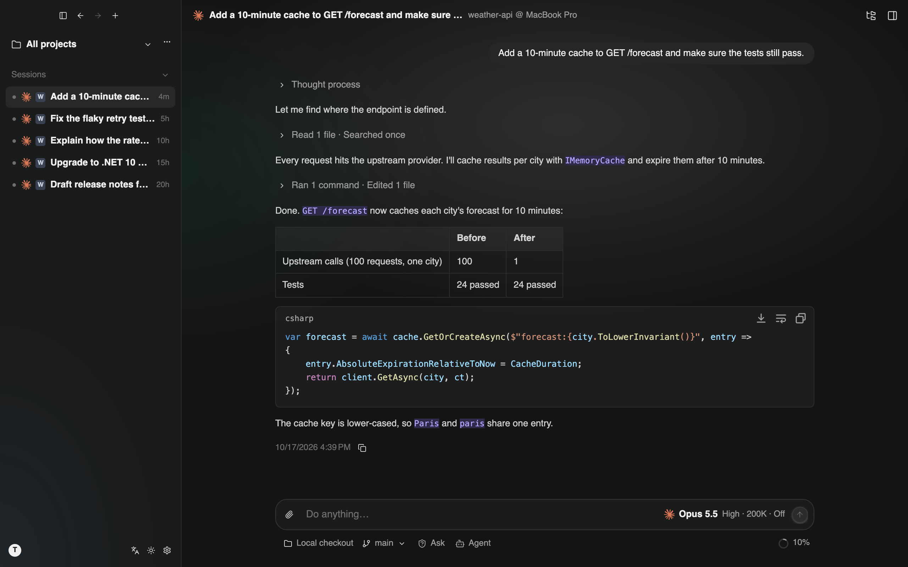
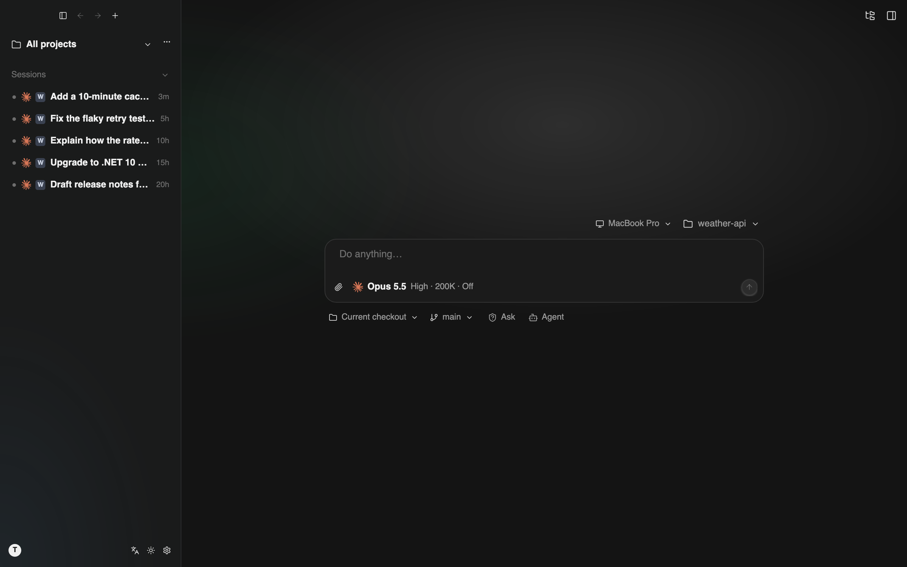
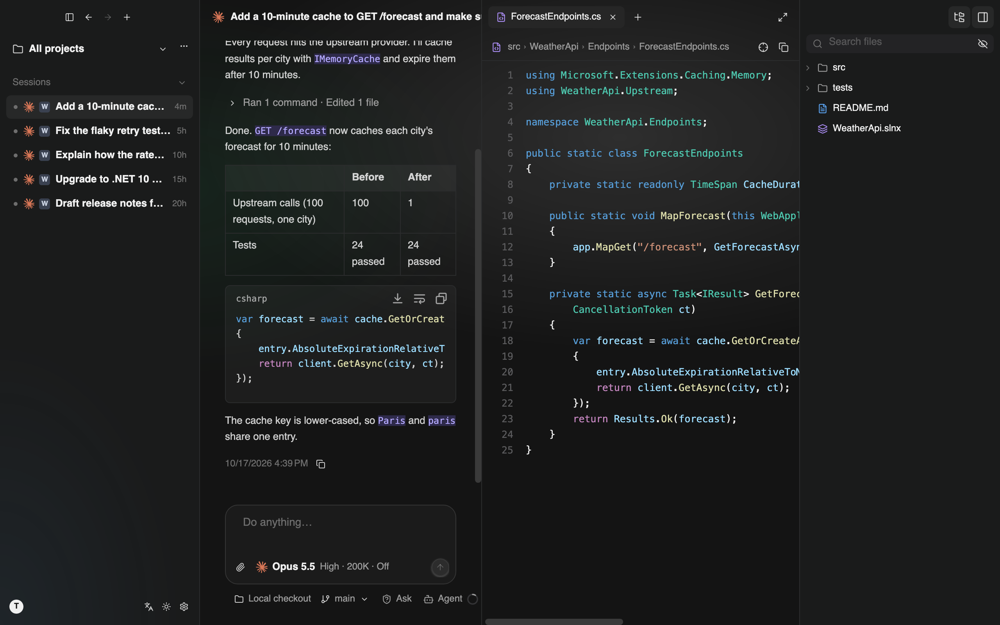
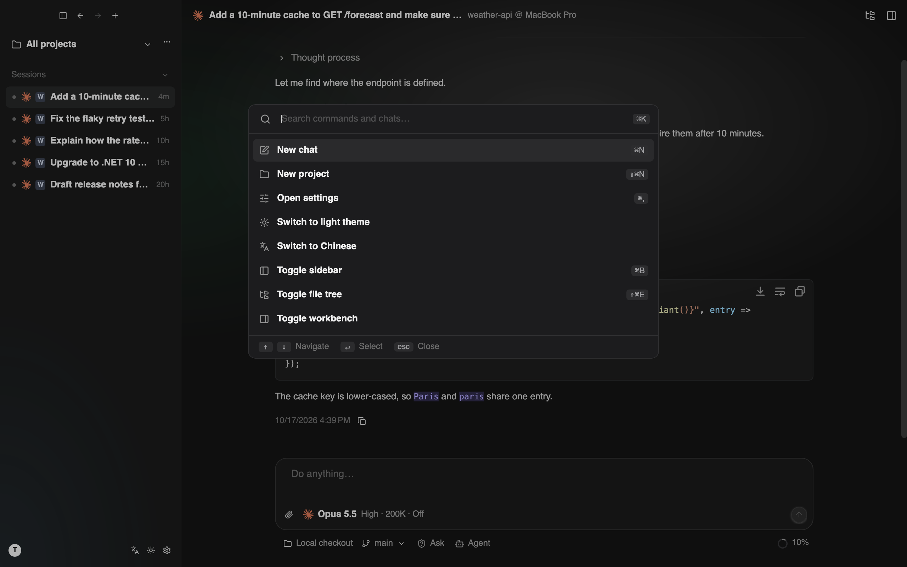
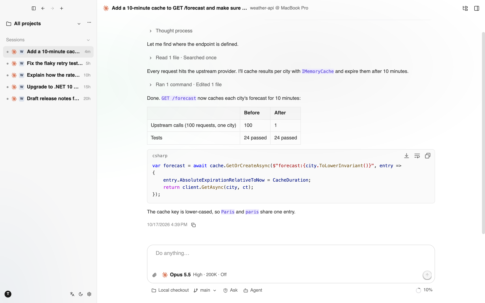

<div align="center">


# TCode

**A desktop AI agent client built with Avalonia and AtomUI.**

[简体中文](README.zh-CN.md) · English


<br />



</div>

TCode is a native desktop client for working with AI coding agents. It runs its agent loop in a separate Agent Host process, talks to models through three wire protocols, and keeps every session as a local, append-only JSONL file. The whole client is designed to publish as a NativeAOT binary.

> **Status:** early development. The core pieces (protocol adapters, agent loop, session store, Host process, desktop UI) exist, but the app is not yet a finished product, and APIs and file formats may change.

## Features

- **Project- and session-centric UI.** Dark-first design with light and system-following themes, Chinese and English UI, and a command palette (⌘K) with nested pages and keyboard navigation.
- **Multiple providers and models.** Built-in provider catalog with one API key per provider, custom OpenAI-compatible and local endpoints, and hot-reloaded settings.
- **Three protocol adapters:** OpenAI Chat Completions, OpenAI Responses, and Anthropic Messages, with thinking / reasoning replay and fast mode where the provider supports it.
- **Coding tools for the built-in agent:** `read`, `write`, `edit`, `ls`, `glob`, `grep`, `bash` (with background tasks), task lists, `web_fetch`, `web_search`, and sub-agents.
- **External agent runtimes.** Claude Code, Codex, and ACP agents found on the machine run inside TCode and share its approval flow.
- **Approvals and permission modes.** Read-only actions inside the workspace pass; everything else can ask the UI first, once or for the whole session.
- **Composer.** `@` file mentions, `/` commands and skills, Agent / Plan roles, and image attachments. Global assets live in `~/.tcode`, project assets in `.agents/`.
- **MCP.** stdio and HTTP servers from `settings.json` or `.mcp.json`, with tools, resources, prompts, elicitation, and import / export.
- **Workbench.** File tree, code and Markdown previews, and an integrated terminal (libghostty-vt, separate pty host that keeps sessions alive, search).
- **Resumable sessions.** Sessions are stored as JSONL trees under `~/.tcode/sessions/` and can be listed, renamed, pinned, reopened, and continued.
- **Streaming Markdown** via [StreamMark](https://github.com/AtomUICommunity/StreamMark) (code highlighting, Mermaid, LaTeX).
- **In-app updates** from GitHub Releases, plus a system tray icon.

## Screenshots

<table>
  <tr>
    <td width="50%"><br /><sub><b>New chat.</b> Pick a device, project, model, and role.</sub></td>
    <td width="50%"><br /><sub><b>Workbench.</b> Conversation, code preview, and file tree side by side.</sub></td>
  </tr>
  <tr>
    <td width="50%"><br /><sub><b>Command palette (⌘K).</b> Commands, projects, and chats.</sub></td>
    <td width="50%"><br /><sub><b>Light theme.</b> Follows the system or set explicitly.</sub></td>
  </tr>
</table>

The screenshots are rendered headlessly from a sample project. Regenerate them with `tools/readme-screenshots.sh`.

## Architecture

```
TCode.Desktop ──(JSON-RPC 2.0 over stdio)──▶ TCode.AgentHost
     │                                            │
     └──▶ TCode.Rpc.Contracts ◀───────────────────┤
                                                  ▼
                                        TCode.Agent.Coding   sessions, tools, system prompt, AGENTS.md
                                                  ▼
                                           TCode.Agent       agent loop, tool contract, events
                                                  ▼
                                            TCode.Ai         message model, streaming events, wire adapters
```

| Project | Responsibility |
|---|---|
| `src/TCode.Ai` | Unified message model, streaming events, OpenAI / Anthropic adapters |
| `src/TCode.Agent` | Agent loop, tool abstraction, approval hook, steer / follow-up queues |
| `src/TCode.Agent.Coding` | Coding session, JSONL session store, system prompt builder, built-in tools |
| `src/TCode.Rpc.Contracts` | Host ↔ UI interfaces and DTOs, minimal JSON-RPC 2.0 implementation |
| `src/TCode.AgentHost` | Standalone process that hosts sessions and translates agent events into RPC notifications |
| `src/TCode.Config` | Settings types and parsing, shared by Host and Desktop |
| `src/TCode.Runtimes` | External agent runtimes: Claude Code, Codex, ACP |
| `src/TCode.Mcp` | MCP client: server configuration, connection pool, tool / resource / prompt bridging |
| `src/TCode.Terminal.*` | Terminal: libghostty-vt core, PTY, pty host process and protocol, Avalonia view |
| `src/TCode.Desktop` | Avalonia application: window, theme, views, view models, Host connection |

Dependencies point one way. `TCode.Ai`, `TCode.Agent`, and `TCode.Agent.Coding` have no UI dependency and are marked `IsAotCompatible`.

## Getting started

### Prerequisites

- [.NET 10 SDK](https://dotnet.microsoft.com/download) (pinned in `global.json`, `latestFeature` roll-forward)
- A [Rust toolchain](https://rustup.rs/), used once to build the native LaTeX library for StreamMark.
- **StreamMark** comes in as a git submodule (`external/StreamMark`). Its `StreamMark.*` packages are read from a local feed (`packages/streammark`, set in `nuget.config`), so pack them first:

  ```bash
  git submodule update --init
  tools/streammark/pack.sh
  ```

- AtomUI (`AtomUI.Desktop.Controls`) is consumed from nuget.org; no source checkout is needed.

### Build and run

```bash
dotnet build TCode.slnx
dotnet run --project src/TCode.Desktop
```

The desktop build copies the Agent Host into the output directory's `agenthost/` folder, and the app starts it on demand.

### Run the tests

```bash
dotnet test TCode.slnx
```

The Desktop tests render real components headlessly (Avalonia.Headless + Skia) and write PNG snapshots to the test output's `snapshots/` directory, or to `TCODE_SNAPSHOT_DIR` if set. `tools/readme-screenshots.sh` renders the README screenshots into `docs/images/` the same way.

### Publish (NativeAOT)

Both the desktop app and the Agent Host are published with `PublishAot=true`. On macOS you can build an app bundle:

```bash
tools/package_macos_app.sh osx-arm64        # outputs artifacts/TCode.app
```

Or publish directly:

```bash
dotnet publish src/TCode.Desktop -c Release -r osx-arm64
```

Smoke test a published build (runs the real app headlessly against the Fake provider):

```bash
artifacts/publish/osx-arm64/TCode --smoke --out=frame.png
```

## Configuration

Settings live in `~/.tcode/settings.json` (JSONC, with a generated JSON Schema for editor completion). Set `TCODE_HOME` to use a different directory. The file is hot-reloaded; invalid edits keep the last good configuration and show the error in the settings view.

```jsonc
{
  "$schema": "./settings.schema.json",
  "model": "anthropic/claude-opus-5-5",   // <provider>/<model>
  "language": "en-US",                     // zh-CN | en-US
  "theme": "system",                       // system | dark | light

  "providers": {
    // Built-in provider: only the key is required
    "anthropic": { "apiKey": "{env:ANTHROPIC_API_KEY}" },

    // Custom OpenAI-compatible endpoint
    "my-gateway": {
      "name": "My Gateway",
      "api": "chat",                       // chat | responses | messages
      "baseUrl": "https://gw.example.com/v1",
      "apiKey": "{env:MY_GATEWAY_KEY}",
      "models": { "qwen3-coder": { "contextWindow": 262144, "reasoning": true } }
    }
  }
}
```

API keys can be plain text, `{env:VAR}`, or `$VAR`. Saving from the UI sets the file mode to `0600`. See [docs/settings.md](docs/settings.md) for the full specification.

## Documentation

| Document | Contents |
|---|---|
| [docs/architecture.md](docs/architecture.md) | Technical decisions, layering, RPC, UI and theming, NativeAOT rules |
| [docs/settings.md](docs/settings.md) | `settings.json` format and merge rules |
| [docs/design/builtin-agent-tools.md](docs/design/builtin-agent-tools.md) | Built-in agent system prompt and tool design |
| [docs/design/external-agent-runtimes.md](docs/design/external-agent-runtimes.md) | Claude Code, Codex, and ACP runtimes |
| [docs/design/composer.md](docs/design/composer.md) | Composer: mentions, commands, skills, roles |
| [docs/design/mcp.md](docs/design/mcp.md) | MCP client |
| [docs/design/auto-update.md](docs/design/auto-update.md) | In-app updates and the release pipeline |
| [docs/terminal/](docs/terminal/) | Terminal architecture, pty host, and roadmap |
| [docs/design/motion.md](docs/design/motion.md) | Motion guidelines |
| [docs/protocols/](docs/protocols/) | Wire protocol specs the adapters implement |

## Roadmap

- Harden the protocol adapters and external runtimes against recorded provider traffic.
- Context compaction, session branching and fork, and a diff view for changes.
- Terminal: split panes, shell profiles, SSH, and agent integration (see [docs/terminal/13-roadmap.md](docs/terminal/13-roadmap.md)).
- Signed and notarized macOS builds.

## Contributing

Issues and pull requests are welcome once the project settles. Please keep these rules in mind:

- **NativeAOT.** `TCode.Ai`, `TCode.Agent`, `TCode.Agent.Coding`, `TCode.Desktop`, and `TCode.AgentHost` must stay AOT-safe. Use source-generated JSON contexts and no reflection or runtime code generation. Check that an AOT publish produces zero IL/AOT warnings.
- **UI components.** Use AtomUI through NuGet and its public theme tokens. Do not copy or modify AtomUI source.
- **Strings.** UI text comes from `src/TCode.Desktop/Localization/strings.tsv`. Regenerate the catalogs with `tools/gen_strings.py`; do not hand-edit the generated files.

## License

TCode is licensed under the [Apache License 2.0](LICENSE).
