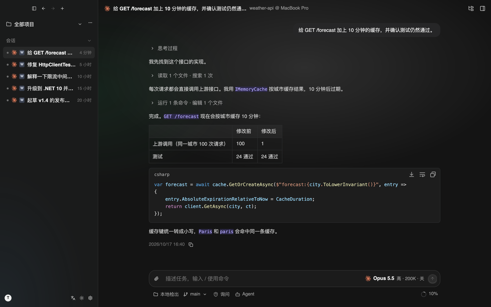
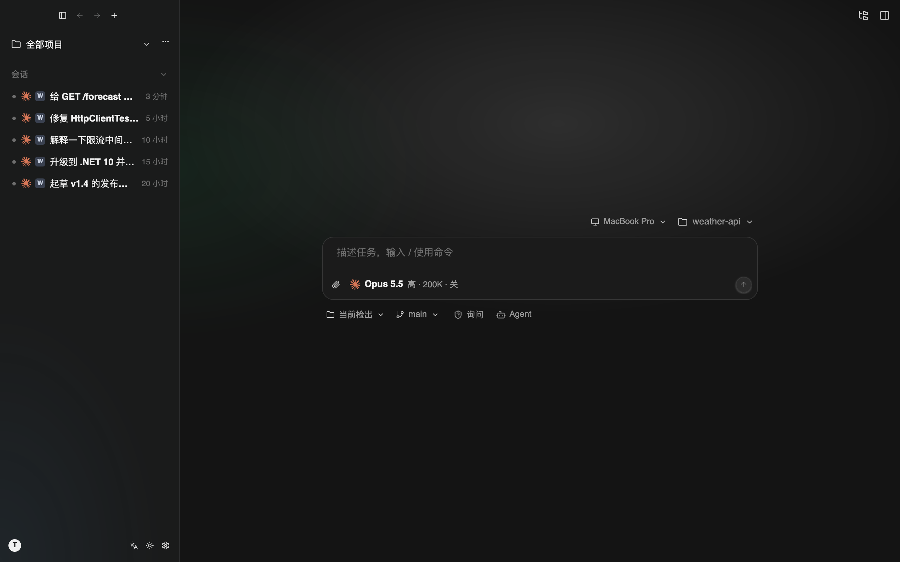
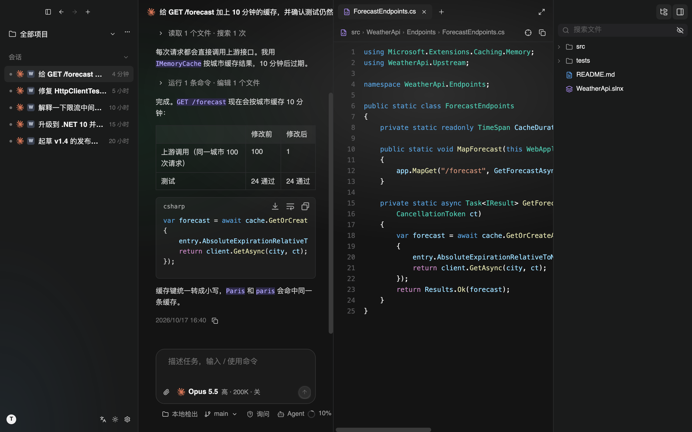
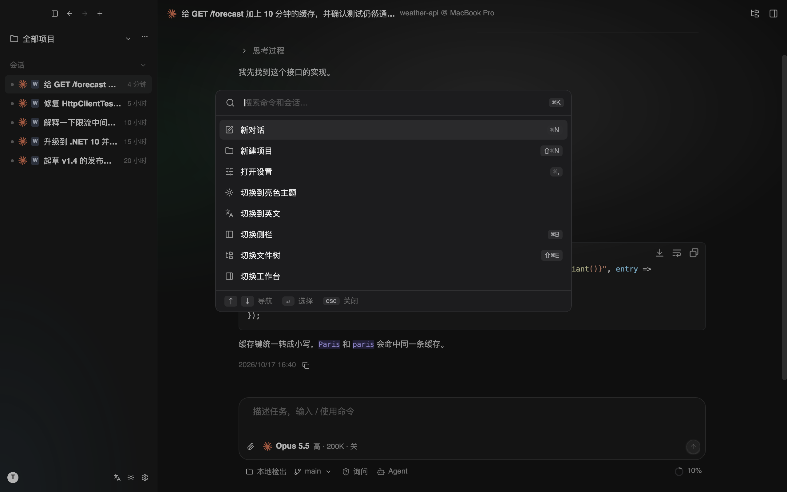
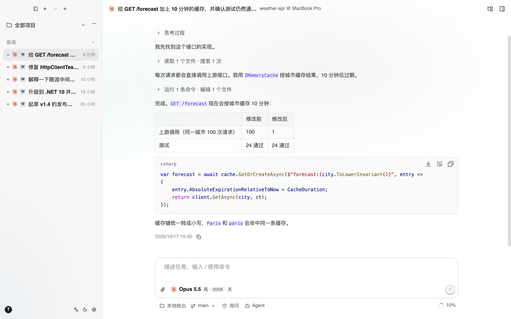

<div align="center">


# TKCode

**基于 Avalonia 与 AtomUI 构建的桌面 AI Agent 客户端。**

简体中文 · [English](README.md)


<br />



</div>

TKCode 是一个用于协作 AI 编程 Agent 的原生桌面客户端。Agent 循环运行在独立的 Agent Host 进程中，通过三种线协议与模型通信，每个会话都以只追加的 JSONL 文件保存在本地。整个客户端按 NativeAOT 发布设计。

> **状态：** 早期开发阶段。协议适配器、Agent 循环、会话存储、Host 进程和桌面界面都已有实现，但还不是完整的产品，接口和文件格式仍可能变化。

## 功能特性

- **以项目 / 会话为中心的界面。** 暗色优先，支持亮色及跟随系统；界面中英双语；命令面板（⌘K）支持多级页面和键盘导航。
- **多厂商、多模型。** 内置厂商目录（每个厂商只需一个 API Key），也支持自定义 OpenAI 兼容端点和本地服务；设置文件修改后自动热重载。
- **三种协议适配器：** OpenAI Chat Completions、OpenAI Responses、Anthropic Messages，支持思考 / 推理内容的原样回放，并在厂商支持时启用快速模式。
- **内置编码工具：** `read`、`write`、`edit`、`ls`、`glob`、`grep`、`bash`（支持后台任务）、任务清单、`web_fetch`、`web_search`，以及子 Agent。
- **外部 Agent 运行时。** 本机已安装的 Claude Code、Codex 和 ACP Agent 可以直接在 TKCode 中运行，并共用 TKCode 的审批流程。
- **审批与权限模式。** 工作区内的只读操作直接放行，其余操作可以先向界面询问，可单次允许或本会话内允许。
- **输入框。** `@` 引用文件、`/` 命令与技能、Agent / Plan 模式、图片附件。全局资源放在 `~/.tkcode`，项目资源放在 `.agents/`。
- **MCP。** 从 `settings.json` 或 `.mcp.json` 读取 stdio 和 HTTP 服务器，支持工具、资源、提示词、信息征询（elicitation）以及导入 / 导出。
- **工作台。** 文件树、代码与 Markdown 预览、集成终端（libghostty-vt，独立的 pty host 进程保持会话，支持搜索）。
- **可恢复的会话。** 会话以 JSONL 树的形式保存在 `~/.tkcode/sessions/`，可以列出、重命名、置顶、重新打开并继续。
- **流式 Markdown**，由 [StreamMark](https://github.com/AtomUICommunity/StreamMark) 提供（代码高亮、Mermaid、LaTeX）。
- **应用内更新**（来自 GitHub Releases）与系统托盘图标。

## 界面截图

<table>
  <tr>
    <td width="50%"><br /><sub><b>新建会话。</b>选择设备、项目、模型和模式。</sub></td>
    <td width="50%"><br /><sub><b>工作台。</b>对话、代码预览和文件树并排显示。</sub></td>
  </tr>
  <tr>
    <td width="50%"><br /><sub><b>命令面板（⌘K）。</b>命令、项目和会话。</sub></td>
    <td width="50%"><br /><sub><b>亮色主题。</b>跟随系统或手动指定。</sub></td>
  </tr>
</table>

截图由示例项目无头渲染生成，可以用 `tools/readme-screenshots.sh` 重新生成。

## 架构

```
TKCode.Desktop ──(JSON-RPC 2.0，经 stdio)──▶ TKCode.AgentHost
     │                                            │
     └──▶ TKCode.Rpc.Contracts ◀───────────────────┤
                                                  ▼
                                        TKCode.Agent.Coding   会话、工具、系统提示、AGENTS.md
                                                  ▼
                                           TKCode.Agent       Agent 循环、工具契约、事件
                                                  ▼
                                            TKCode.Ai         统一消息模型、流式事件、协议适配器
```

| 项目 | 职责 |
|---|---|
| `src/TKCode.Ai` | 统一消息模型、流式事件、OpenAI / Anthropic 适配器 |
| `src/TKCode.Agent` | Agent 循环、工具抽象、审批钩子、steer / followUp 队列 |
| `src/TKCode.Agent.Coding` | 编码会话、JSONL 会话存储、系统提示构建、内置工具 |
| `src/TKCode.Rpc.Contracts` | Host 与界面之间的接口和 DTO，精简的 JSON-RPC 2.0 实现 |
| `src/TKCode.AgentHost` | 独立进程：托管多个会话，并把 Agent 事件翻译为 RPC 通知 |
| `src/TKCode.Config` | 设置类型与解析，Host 和桌面端共用 |
| `src/TKCode.Runtimes` | 外部 Agent 运行时：Claude Code、Codex、ACP |
| `src/TKCode.Mcp` | MCP 客户端：服务器配置、连接池、工具 / 资源 / 提示词的桥接 |
| `src/TKCode.Terminal.*` | 终端：libghostty-vt 核心、PTY、pty host 进程与协议、Avalonia 视图 |
| `src/TKCode.Desktop` | Avalonia 应用：窗口、主题、视图、ViewModel、Host 连接 |

依赖方向严格单向。`TKCode.Ai`、`TKCode.Agent`、`TKCode.Agent.Coding` 不依赖任何 UI，并标记为 `IsAotCompatible`。

## 快速开始

### 环境要求

- [.NET 10 SDK](https://dotnet.microsoft.com/download)（版本在 `global.json` 中锁定，滚动策略为 `latestFeature`）
- [Rust 工具链](https://rustup.rs/)：用于构建 StreamMark 的 LaTeX 原生库，只在打包时需要一次。
- **StreamMark** 以 git 子模块的形式放在 `external/StreamMark`。`StreamMark.*` 包从本地源读取（`nuget.config` 中指定的 `packages/streammark`），需要先打包：

  ```bash
  git submodule update --init
  tools/streammark/pack.sh
  ```

- AtomUI（`AtomUI.Desktop.Controls`）直接从 nuget.org 引用，无需源码。

### 构建与运行

```bash
dotnet build TKCode.slnx
dotnet run --project src/TKCode.Desktop
```

桌面端构建时会把 Agent Host 复制到输出目录的 `agenthost/` 子目录中，应用在需要时自动启动它。

### 运行测试

```bash
dotnet test TKCode.slnx
```

桌面端测试使用 Avalonia.Headless + Skia 渲染真实组件，把 PNG 截图写入测试输出目录下的 `snapshots/`，也可以用 `TKCODE_SNAPSHOT_DIR` 指定目录。`tools/readme-screenshots.sh` 用同样的方式把 README 截图渲染到 `docs/images/`。

### 发布（NativeAOT）

桌面端和 Agent Host 都以 `PublishAot=true` 发布。macOS 上可以直接生成 .app 包：

```bash
tools/package_macos_app.sh osx-arm64        # 输出到 artifacts/TKCode.app
```

或直接发布：

```bash
dotnet publish src/TKCode.Desktop -c Release -r osx-arm64
```

对发布产物做冒烟测试（以无头平台运行真实界面，使用 Fake 模型）：

```bash
artifacts/publish/osx-arm64/TKCode --smoke --out=frame.png
```

## 配置

设置文件位于 `~/.tkcode/settings.json`（JSONC 格式，附带自动生成的 JSON Schema，编辑器可以补全）。设置 `TKCODE_HOME` 环境变量可以改用其它目录。文件修改后会热重载；如果写入的内容有错误，程序保留上一次正确的配置，并在设置界面中显示错误。

```jsonc
{
  "$schema": "./settings.schema.json",
  "model": "anthropic/claude-opus-5-5",   // <厂商>/<模型>
  "language": "zh-CN",                     // zh-CN | en-US
  "theme": "system",                       // system | dark | light

  "providers": {
    // 内置厂商：只需要 Key
    "anthropic": { "apiKey": "{env:ANTHROPIC_API_KEY}" },

    // 自定义的 OpenAI 兼容端点
    "my-gateway": {
      "name": "My Gateway",
      "api": "chat",                       // chat | responses | messages
      "baseUrl": "https://gw.example.com/v1",
      "apiKey": "{env:MY_GATEWAY_KEY}",
      "models": { "qwen3-coder": { "contextWindow": 262144, "reasoning": true } }
    }
  }
}
```

API Key 可以写明文、`{env:VAR}` 或 `$VAR`。在界面中保存时，文件权限会设为 `0600`。完整规格见 [docs/settings.md](docs/settings.md)。

## 文档

| 文档 | 内容 |
|---|---|
| [docs/architecture.md](docs/architecture.md) | 技术决策、分层、RPC、界面与主题、NativeAOT 约束 |
| [docs/settings.md](docs/settings.md) | `settings.json` 格式与合并规则 |
| [docs/design/builtin-agent-tools.md](docs/design/builtin-agent-tools.md) | 内置 Agent 的系统提示与工具设计 |
| [docs/design/external-agent-runtimes.md](docs/design/external-agent-runtimes.md) | Claude Code、Codex、ACP 运行时 |
| [docs/design/composer.md](docs/design/composer.md) | 输入框：引用、命令、技能、模式 |
| [docs/design/mcp.md](docs/design/mcp.md) | MCP 客户端 |
| [docs/design/auto-update.md](docs/design/auto-update.md) | 应用内更新与发布流程 |
| [docs/terminal/](docs/terminal/) | 终端架构、pty host 与路线图 |
| [docs/design/motion.md](docs/design/motion.md) | 动效规范 |
| [docs/protocols/](docs/protocols/) | 适配器实现所依据的线协议规格 |

## 路线图

- 用录制的真实流量加固协议适配器和外部运行时。
- 上下文压缩、会话分支与 fork、变更 diff 视图。
- 终端：分屏、Shell 配置、SSH 与 Agent 集成（见 [docs/terminal/13-roadmap.md](docs/terminal/13-roadmap.md)）。
- 签名并公证的 macOS 构建。

## 参与贡献

项目趋于稳定后欢迎提交 Issue 和 Pull Request。请注意以下约定：

- **NativeAOT。** `TKCode.Ai`、`TKCode.Agent`、`TKCode.Agent.Coding`、`TKCode.Desktop`、`TKCode.AgentHost` 必须保持 AOT 兼容：使用源生成的 JSON 上下文，不使用反射或运行时代码生成。AOT 发布应当做到 0 个 IL / AOT 警告。
- **UI 组件。** 通过 NuGet 使用 AtomUI 及其公开的主题 Token，不复制或修改 AtomUI 源码。
- **文案。** 界面文字的唯一来源是 `src/TKCode.Desktop/Localization/strings.tsv`。用 `tools/gen_strings.py` 重新生成目录，不要手改生成文件。

## 许可证

TKCode 基于 [Apache License 2.0](LICENSE) 开源。
