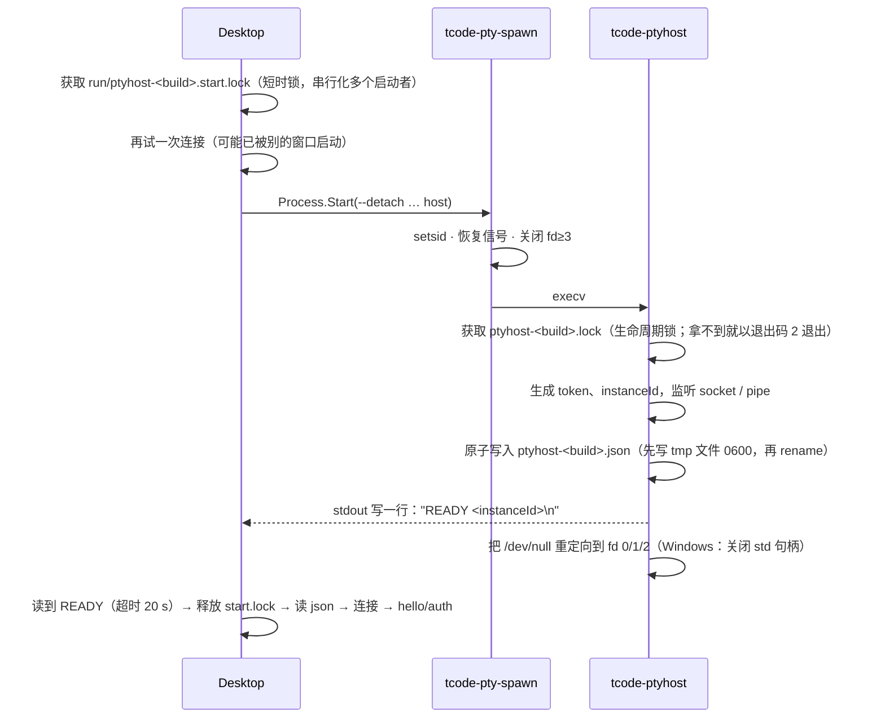
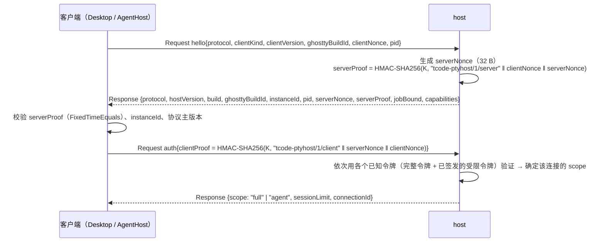
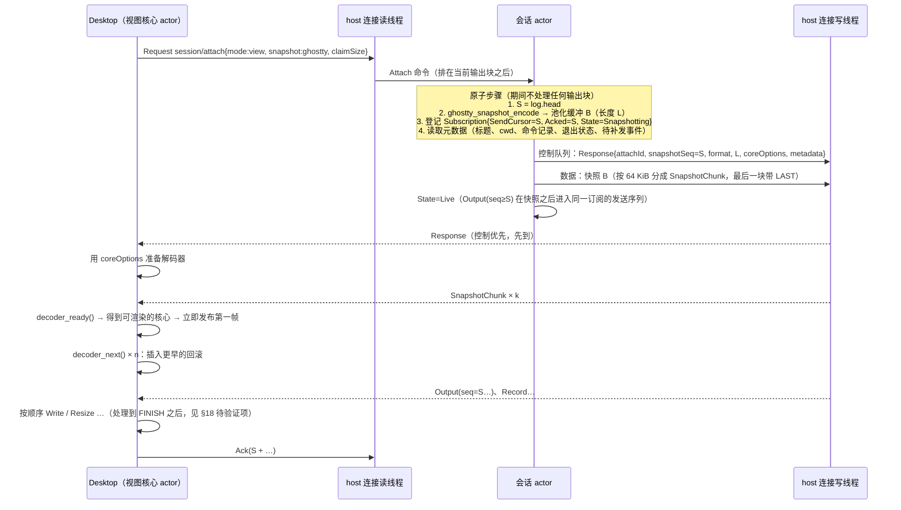
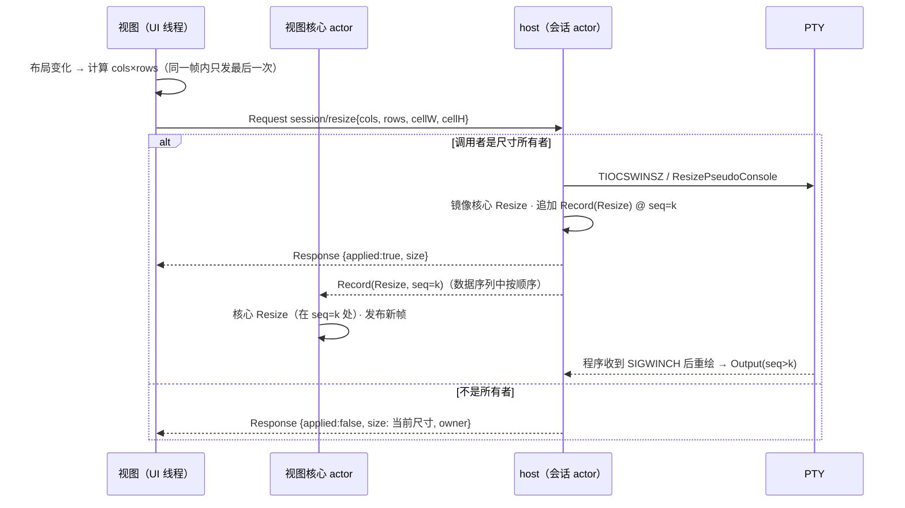
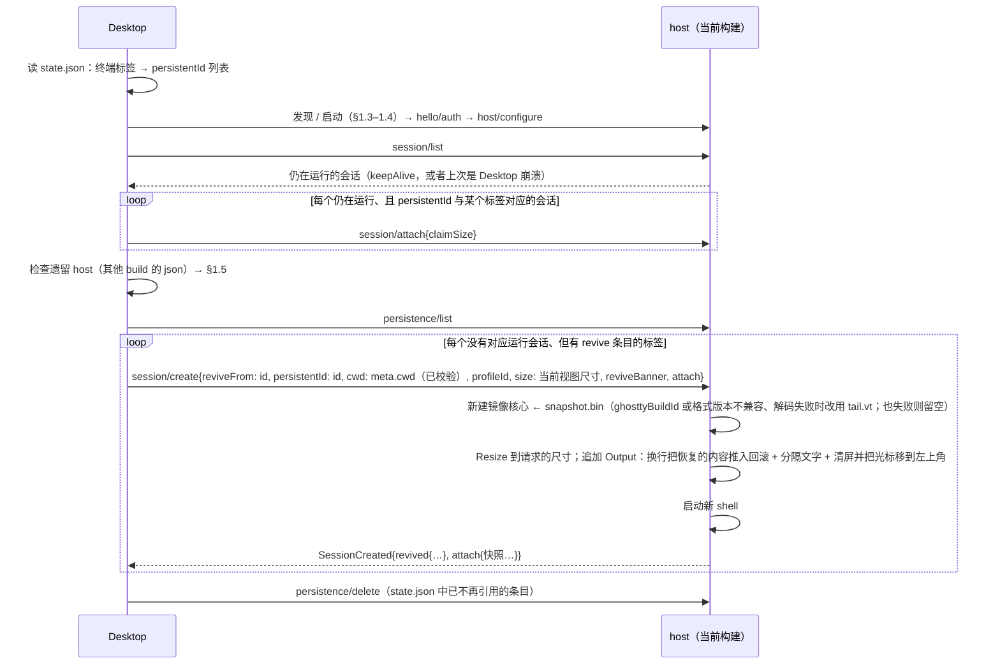
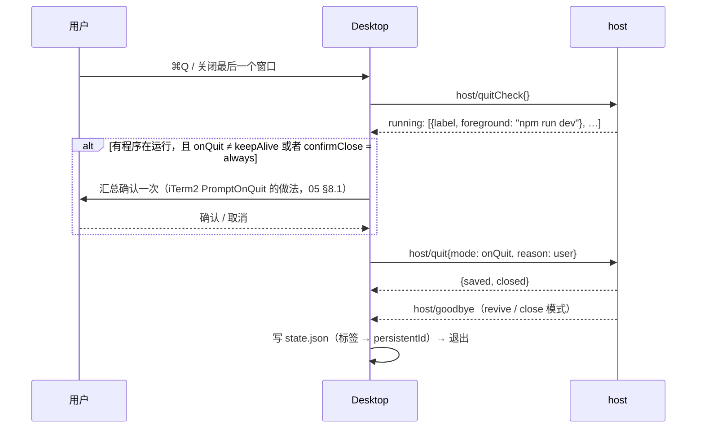

# TCode 终端：pty host 进程与 IPC 协议

> 状态：设计稿 v1（2026-10-16）。范围：`TCode.Terminal.Protocol`（帧格式、控制消息、流控、`PtyHostClient`、启动与发现）和 `TCode.Terminal.Host`（`tcode-ptyhost` 可执行文件：会话管理、镜像核心、输出日志、持久化）。
> 上位文档：[01-architecture.md](01-architecture.md) §3（进程划分、一致性规则、生命周期）、§5（线程模型）、§6.4（IPC 要点）、§8（安全）、决策 D3。本文细化这些约定；与 01 不一致的地方列在 §19。
> 相关：[02-core-ghostty.md](02-core-ghostty.md)（快照、formatter、回滚压缩）、[07-shell-profiles-config.md](07-shell-profiles-config.md)（profile、环境变量、`terminal` 配置节）、[09-agent-integration.md](09-agent-integration.md)（`command/*` 细节、审批）、[10-protocol-compat.md](10-protocol-compat.md)（OSC 52、查询应答）、[11-testing-benchmarks.md](11-testing-benchmarks.md)。

来源标注：**[实]** = 本次读过源码、头文件或文档并核对过；**[推]** = 推断或经验值，需要实测；**[定]** = 本文做出的设计决定。外部源码版本：VS Code `4765bd3`（2026-10-16），Ghostty `b3dc3d7`（2026-10-15），dotnet/runtime `main`（2026-10-16 读取）。

---

## 0. 结论摘要

| 主题 | 结论 |
|---|---|
| 进程 | `ptyhost/tcode-ptyhost[.exe]`，与 `agenthost/` 并列发布。Desktop 按需启动。Unix 下经 `tcode-pty-spawn --detach` 执行 `setsid` 并关闭多余 fd；Windows 用 `CreateProcessW` + `CREATE_BREAKAWAY_FROM_JOB \| DETACHED_PROCESS \| CREATE_NEW_PROCESS_GROUP` |
| 单例与发现 | `$TCODE_HOME/run/`（0700）下，每个**构建**一个 host：`ptyhost-<build>.json`（0600）+ `ptyhost-<build>.lock`。host 在整个生命周期内持有 `.lock`，所以"锁拿得到"就说明 host 已死，不依赖 pid 判断 |
| 升级 | 新旧构建的 host 可以并存。新会话只建在当前构建的 host 里；旧 host 只"排空"：协议主版本相同时用 VT 兼容模式 attach，主版本不同时只能用冻结的引导子集（列出 / 保存 / 退出） |
| 认证 | 文件权限 + 对端凭据（`SO_PEERCRED` / `getpeereid` / 管道 SID）+ 基于 32 字节令牌的 **HMAC 双向挑战应答**（令牌本身不上线）。AgentHost 使用 Desktop 签发的**受限令牌** |
| 帧 | 12 字节头 `[u32 len][u8 type][u8 flags][u16 rsv][u32 session][payload]`，小端。控制帧载荷为源生成 JSON（≤ 1 MiB），数据帧（Output / Record / Snapshot / Input）载荷 ≤ 64 KiB |
| 日志 | 每个会话一条带**位置序号**的日志：Output 记录按字节数推进位置，Resize / SetColors / Reset / Clear 记录各占 1。默认环形保留 1 MiB |
| 流控 | 按订阅者独立计算：`backlog = head − acked`。backlog > 256 KiB 时暂停读 PTY；客户端每处理 32 KiB 回一次 Ack；所有 UI 订阅者都 < 64 KiB 时恢复。订阅者连续 10 s 不消化就降级，之后重新 attach（resync），不会无限期卡住 shell |
| 重连 | `session/attach` 在会话 actor 上原子地完成三件事：取 `S = head`、编码快照、登记游标 = S。快照字节流（READY 段在前）和 `Output(seq ≥ S)` 在同一个数据队列里按顺序发送，所以不重不漏 |
| 持久化 | `$TCODE_HOME/terminal/revive/<persistentId>/`：`snapshot.bin`（libghostty 快照，裁剪到 N 行）+ `tail.vt`（formatter 产出的 VT 文本，供跨版本恢复）+ `meta.json`；每 30 s 保存有变化的会话；目录 0700，文件 0600 |
| 心跳 | 双向 Ping，空闲 5 s 发一次。客户端 6 s + 5 s 收不到任何帧时判定 host 无响应（与 VS Code 相同）；host 30 s 收不到客户端的帧就断开该连接 |
| 宽限期 | 没有 UI 连接后开始计时，默认 30 min（只计清醒时间），到期按 `revive` 方式退出。用户主动选择 `keepAlive` 退出时不计时 |

---

## 1. 进程

### 1.1 可执行文件与发布布局

| 项 | 值 |
|---|---|
| 项目 | `src/TCode.Terminal.Host/TCode.Terminal.Host.csproj`：`OutputType=Exe`、`AssemblyName=tcode-ptyhost`、`PublishAot=true`、`InvariantGlobalization=true`（host 不做本地化，所有面向用户的文字都由 Desktop 传入） |
| 发布位置 | 与 AgentHost 并列：`<Desktop 发布目录>/ptyhost/`。macOS 包内为 `TCode.app/Contents/MacOS/ptyhost/` |
| 目录内容 | `tcode-ptyhost[.exe]`、`tcode-pty-spawn`（Unix）、`libghostty-vt.{dylib,so,dll}`、`libtcodepty.{dylib,so}`（Unix）、`conpty.dll` + `OpenConsole.exe`（Windows，D9）、`ghostty-build.txt`（构建 ID，见 §2.4） |
| MSBuild | 仿照 `CopyAgentHost` / `PublishAgentHost`（[TCode.Desktop.csproj:36-54](../../src/TCode.Desktop/TCode.Desktop.csproj) [实]），新增 `CopyPtyHost` / `PublishPtyHost`，用相同的 RID 和 `PublishAot` 发布到 `ptyhost/` |
| 测试覆盖 | 环境变量 `TCODE_PTYHOST_DIR` 指向 host 的构建输出（与 `TCODE_AGENTHOST_DIR` 相同的做法，见 [AgentHostConnection.cs:54-58](../../src/TCode.Desktop/Services/AgentHostConnection.cs) [实]） |
| 自检 | `tcode-ptyhost --self-test`：启动 `/bin/sh`（或 `cmd.exe`），完成一次往返、resize、快照编码与解码后退出，返回码 0。CI 中的 AOT 冒烟测试运行它 |

libghostty-vt 在 Desktop 根目录和 `ptyhost/` 中各有一份，**字节完全相同**（来自同一次构建）。握手时比较构建 ID（§2.4），满足 01 §3.2 规则 3。

### 1.2 命令行

```
tcode-ptyhost --home <TCODE_HOME> --build <buildId> --ready-fd 1 [--log-level info] [--parent-pid <pid>]
tcode-ptyhost --self-test
```

| 参数 | 说明 |
|---|---|
| `--home` | 显式传入，不依赖继承的环境变量（Desktop 可能用 `TCODE_HOME` 覆盖过数据目录） |
| `--build` | Desktop 计算出的构建 ID。host 启动后自己再算一遍，不一致就以退出码 3 退出（防止 Desktop 和 host 的文件来自不同的安装） |
| `--ready-fd` | 就绪通知写到哪个 fd（Unix）。Windows 上固定使用继承进来的 stdout 句柄 |
| `--parent-pid` | 仅用于日志 |

### 1.3 启动方式：脱离 Desktop

目标：Desktop 崩溃、被杀、从终端启动后终端被关闭时，host 都不受影响（01 §3.3）。

| 平台 | 做法 | 理由 |
|---|---|---|
| macOS / Linux | Desktop 用 `Process.Start` 执行 `ptyhost/tcode-pty-spawn --detach --stdout-fd 1 -- ptyhost/tcode-ptyhost …`，stdin 为 `/dev/null`，stdout 为管道（用于读就绪行），stderr 为管道。helper 在 `--detach` 模式下：① `setsid()`；② 把信号处理恢复为默认、清空信号掩码；③ `close_range(3, ~0U, 0)`（Linux ≥ 5.9），旧内核逐个关闭 `/proc/self/fd` 中的 fd，macOS 遍历 `/dev/fd`；④ `execv(host)` | `setsid` 让 host 成为新会话的首进程，没有控制终端：Desktop 所在终端关闭时的 SIGHUP、Ctrl+C 产生的 SIGINT 都到不了 host [实，POSIX 语义]。.NET 只对自己打开的 fd 设置 `O_CLOEXEC`，Avalonia 等原生库打开的 fd 可能被继承下来。如果 host 持有 Desktop 某个 socket 的副本，对端就永远收不到 EOF，所以必须在 exec 前关掉 [推] |
| Windows | Desktop 用 `LibraryImport` 调 `CreateProcessW`。标志：`CREATE_BREAKAWAY_FROM_JOB \| CREATE_NEW_PROCESS_GROUP \| DETACHED_PROCESS \| CREATE_UNICODE_ENVIRONMENT \| EXTENDED_STARTUPINFO_PRESENT`；用 `PROC_THREAD_ATTRIBUTE_HANDLE_LIST` 只让子进程继承就绪管道的写端 | Desktop 可能运行在某个 Job 中（调试器、某些启动器、CI），子进程默认会继承这个 Job，Job 关闭时一起被杀。`CREATE_BREAKAWAY_FROM_JOB` 只有在 Job 设置了 `JOB_OBJECT_LIMIT_BREAKAWAY_OK` 时才有效，否则 `CreateProcess` 返回 `ERROR_ACCESS_DENIED` [推，依据 Win32 文档语义]。`.NET Process.Start` 无法传这些标志 |
| Windows 回退 | 收到 `ERROR_ACCESS_DENIED` 时去掉 BREAKAWAY 再启动，并在 `hello` 应答中带 `jobBound: true`。Desktop 据此把 `keepAlive` 选项置灰，并说明"当前环境下终端会随 TCode 一起退出" | 备选方案是用 WMI `Win32_Process.Create` 在 Job 之外创建进程。它依赖 COM，AOT 下成本高，v1 不做 |

**就绪握手（启动时序）**：



- 超时取 20 s，对应 VS Code 的 `ConnectingBeatInterval = 20000`，给慢机器留出余量（`common/terminal.ts:476` [实]）。
- 退出码：0 正常；2 已有同构建的 host 在运行（Desktop 收到后直接连接它）；3 构建 ID 不一致；4 无法创建运行时目录或 socket；其他值为崩溃。
- 读到 READY 后，Desktop 立即释放 `Process` 对象，**不 Kill**。host 已经是 init / launchd / systemd 子收割者的孙进程（Unix），或者是 Job 之外的独立进程（Windows）。

### 1.4 单例发现

**目录布局** [定]：

```
$TCODE_HOME/run/                         0700（Windows：继承用户配置目录的 ACL）
  ptyhost-<build>.json                   0600，每个运行中的 host 一份
  ptyhost-<build>.lock                   host 生命周期锁（独占）
  ptyhost-<build>.start.lock             启动者之间的短时锁
  ptyhost-<build>.sock                   Unix socket（路径过长时放到别处，见 §2.2）
```

`<build>` = `hex(SHA-256(protocolMajor ‖ appVersion ‖ ghosttyBuildId))[0..12]`。之所以按构建区分而不是"每个用户只有一个"，原因见 §1.5。

**`ptyhost-<build>.json`**（源生成，`PtyHostRegistration`）：

```jsonc
{
  "formatVersion": 1,
  "pid": 41237,
  "processStartTime": "2026-10-16T14:03:11.512Z", // Linux /proc/<pid>/stat 第 22 列；macOS proc_pidinfo；Windows GetProcessTimes
  "instanceId": "01JAB3…",                         // 每次启动随机生成（ULID）
  "endpoint": "/Users/u/.tcode/run/ptyhost-3f9a1c0d2b7e.sock", // Windows：\\.\pipe\tcode-ptyhost-<hash>
  "token": "base64url(32 字节)",                   // 完整权限令牌
  "protocol": { "major": 1, "minor": 0 },
  "hostVersion": "0.9.0",
  "build": "3f9a1c0d2b7e",
  "ghosttyBuildId": "1.3.1+sha256:6b0e…",
  "startedAt": "2026-10-16T14:03:11.600Z",
  "jobBound": false
}
```

**陈旧文件与 pid 复用的检测**（按顺序判断，前一层就能得出结论时不再看后面）：

| 层 | 检查 | 结论 |
|---|---|---|
| 1 | 尝试以非阻塞方式获取 `ptyhost-<build>.lock`（Unix：`FileStream` + `FileShare.None`，.NET 在 Unix 上用 `flock(LOCK_EX\|LOCK_NB)` 实现 [推]；Windows：共享模式为 0 的打开方式是强制锁） | **能拿到锁说明 host 已死**：删除 json 和 sock，然后释放锁。host 进程退出（包括崩溃、被 SIGKILL）时内核自动释放锁，所以 pid 被复用也不会误判 |
| 2 | 拿不到锁 → 读 json，连接 endpoint | 连接被拒绝或超时（2 s）：host 可能卡住了，按"无响应"处理（§1.6），**不删文件** |
| 3 | 握手应答中的 `instanceId` 和 `pid` 必须与 json 一致，`serverProof` 必须验证通过 | 不一致：文件被篡改或抢注，拒绝连接并记录安全日志 |

`processStartTime` 只用于诊断日志（把"pid 还在，但已经不是那个进程"的情况写清楚）。存活判断只看锁。

### 1.5 升级时新旧 host 并存

01 §3.3 要求"UI 升级重启后会话仍在运行"。升级后 Desktop 是新构建，正在运行的 host 是旧构建，01 §3.2 规则 3 又要求两侧使用同一个 libghostty 构建。处理方式 [定]：

| 情形 | 判定 | 行为 |
|---|---|---|
| 同构建 | `build` 相同 | 正常 attach（libghostty 二进制快照） |
| 协议主版本相同，构建不同（通常是 libghostty 或应用版本变了） | `protocol.major` 相同 | 旧 host 成为**遗留 host**：Desktop 可以 attach 它的会话，但 `snapshotFormat = "vt"`（formatter 输出带回滚的 VT 文本，见 §8.5），标签上显示"旧版本会话"标记。**新会话只在当前构建的 host 中创建**。遗留 host 的最后一个会话关闭后，host 立即退出 |
| 协议主版本不同 | `protocol.major` 不同 | 只能使用**冻结的引导子集**（§4.9）：`hello`、`auth`、`session/list`、`persistence/save`、`host/quit`。Desktop 弹出提示："N 个旧版本终端仍在运行（其中 M 个有程序在运行：…）"。选项：**关闭并恢复内容**（默认：先 `persistence/save`，再 `host/quit{mode:"revive"}`，然后由新 host 按 revive 流程恢复）/ **保留**（旧 host 继续运行，直到程序结束或系统重启；"终端"菜单中保留一个入口，可以稍后关闭） |

补充规则：

- 遗留 host 不接受 `session/create`（返回 `HostDraining`），避免它从已被替换的安装目录启动 `tcode-pty-spawn`。macOS 升级会替换 `.app`，旧 helper 文件已经不存在了 [推]。
- 协议版本只增不减：`minor` 的变化必须向后兼容，只能新增可选字段、新方法、带 `IGNORABLE` 标志的新帧类型；`major` 的变化允许不兼容，但**引导子集的帧头、方法名和字段永远不变**。
- 构建 ID 不同意味着两个核心不是同一个构建。VT 兼容模式下 UI 侧核心可能在极少数边界情况与镜像核心不一致。查询应答始终来自镜像核心，所以程序看到的行为不受影响，影响只限于显示（[推]，列入 §18）。

### 1.6 心跳

| 方向 | 规则 | 依据 |
|---|---|---|
| 双向 | 一端在 5 s 内没有发出任何帧时，发送 `Ping`；对端收到后立即回 `Pong`（控制优先级） | VS Code `BeatInterval = 5000` [实 `common/terminal.ts:470`] |
| 客户端判定 host 无响应 | 6 s（5 s × 1.2）内没收到任何帧 → 记警告，开始第二次计时；再过 5 s 仍没有 → 触发 `Unresponsive`。UI 显示"终端服务无响应"横幅，但**不断开、不杀进程**。之后收到任何帧就恢复 | VS Code 两段计时 `FirstWaitMultiplier = 1.2`、`SecondWaitMultiplier = 1`，第二段用来避免电脑刚从睡眠唤醒时误报 [实 `common/terminal.ts:481-487`；`ptyHostService.ts:380-400`] |
| `session/create` 超时 | 5 s 没有应答 → 立即提示无响应（不等心跳） | VS Code `CreateProcessTimeout = 5000` [实 `common/terminal.ts:493`] |
| host 判定客户端已死 | 30 s 没有收到该连接的任何帧 → 关闭连接，等同于断开 | [定]，比客户端的判定宽松，因为 UI 进程可能被调试器暂停 |
| 时钟 | 全部使用单调时钟（`Stopwatch.GetTimestamp`） | — |

### 1.7 宽限期

| 项 | 规则 |
|---|---|
| 开始 | 最后一个 `ui` 类型的连接断开，而且没有收到 `host/quit`（即异常断开，例如 Desktop 崩溃或被杀）。只剩 `agent` 连接时也开始计时（AgentHost 是 Desktop 的子进程，通常会随之退出） |
| 时长 | `terminal.persistence.orphanGraceMinutes`，默认 **30**（01 §3.3）。由 Desktop 通过 `host/configure` 下发，host 记在内存里 |
| 计时 | 只计清醒时间：Unix 用 `CLOCK_MONOTONIC`（macOS 的 `mach_absolute_time` 和 Linux 的 `CLOCK_MONOTONIC` 在睡眠期间都不前进 [推]）；Windows 用 `QueryUnbiasedInterruptTime`（不含睡眠和休眠时间 [推]）。VS Code 的重连宽限期使用 `ProcessTimeRunOnceScheduler`，用意相同 [实 `ptyService.ts:803-811`] |
| 取消 | 任何 `ui` 连接完成 `auth` |
| 到期 | 执行 `host/quit{mode:"revive", reason:"orphanTimeout"}`：保存快照 → 关闭全部会话 → 退出 |
| 例外 | 用户选择 `keepAlive` 退出时（`host/quit{mode:"keepAlive"}`）**不计时**，与 tmux 相同；可以用 `terminal.persistence.keepAliveMaxHours` 设置上限，默认不限制 |
| 无会话 | 没有任何会话、也没有任何连接时，60 s 后退出（避免空 host 常驻） |

### 1.8 host 崩溃后 Desktop 的行为

1. 检测：读到 EOF / `ECONNRESET`，或者 `Process` 退出事件（只有本 Desktop 启动的 host 才有这个事件）。
2. 所有已 attach 的视图冻结在最后一帧，叠加提示"终端会话已丢失（终端服务意外退出）"，按钮为 **在相同目录重新打开**。点击后用最近一次 revive 快照（host 每 30 s 保存一次）新建会话：`session/create{reviveFrom: persistentId}`（§10.5）。
3. **不自动重启正在运行的程序**（01 §3.3）。host 本身在下一次需要终端时才会重新启动，不会立即拉起。
4. 防止崩溃循环：5 min 内崩溃 ≥ 3 次后停止自动启动，显示错误和日志路径，提供"重试"按钮。VS Code 的上限是 `MaxRestarts = 5`（[实 `ptyHostService.ts:26,164`]），但 VS Code 会立即重启 host，我们是按需启动，所以阈值取得更小。
5. host 退出时 PTY master 被关闭，内核会向各会话的前台进程组发送 SIGHUP（Unix），Windows 上 ConPTY 也随之结束。所以 host 崩溃就等于会话丢失，这与 01 一致。

### 1.9 日志

| 项 | 值 |
|---|---|
| 位置 | `$TCODE_HOME/logs/ptyhost/ptyhost-<yyyyMMdd-HHmmss>-<pid>.log` |
| 实现 | 自写的极简 `ILoggerProvider`：后台线程批量写入文件，AOT 安全，不引入第三方库。host 没有 stdout / stderr（§1.3 已重定向到 `/dev/null`） |
| 轮转 | 单个文件 ≤ 5 MiB，最多保留 10 个文件 |
| 级别 | `--log-level` 或环境变量 `TCODE_PTYHOST_LOG`（`trace\|debug\|info\|warn`），默认 `info` |
| 隐私 | **从不记录终端内容、输入字节、剪贴板内容和环境变量的值。** 只有同时设置 `TCODE_PTYHOST_LOG=trace` 和 `TCODE_PTYHOST_LOG_DATA=1` 时，才记录数据的前 64 字节（以十六进制） |
| 崩溃 | 托管异常：`AppDomain.UnhandledException` 写入日志后退出。原生崩溃（libghostty、libtcodepty）由系统崩溃报告记录：macOS `~/Library/Logs/DiagnosticReports`，Windows WER（可以配置 LocalDumps），Linux 为 core / systemd-coredump。NativeAOT 没有 `createdump` [推] |
| Desktop 侧 | `PtyHostClient` 的日志写入 Desktop 自己的日志；断开原因和 host 退出码都要记录 |

---

## 2. 传输与认证

### 2.1 传输

| 平台 | 传输 | 服务端 | 客户端 |
|---|---|---|---|
| macOS / Linux | `AF_UNIX` + `SOCK_STREAM` | `Socket.Bind(new UnixDomainSocketEndPoint(path))`，`Listen(32)`。bind 之前先 `umask(0077)`，bind 之后再 `chmod 0600`（双保险） | `Socket.ConnectAsync`，之后包装成 `NetworkStream` |
| Windows | 命名管道，字节模式 | **自己调 `CreateNamedPipeW`**（`LibraryImport`），见下方说明，再用 `new NamedPipeServerStream(PipeDirection.InOut, isAsync: true, isConnected: false, safeHandle)` 包装 | `NamedPipeClientStream(".", name, InOut, Asynchronous)`，连接后校验服务端身份（§2.3） |

为什么 Windows 上要自己创建管道：.NET 的 `NamedPipeServerStream` 构造管道时**不设置 `PIPE_REJECT_REMOTE_CLIENTS`**；`CurrentUserOnly` 只是给当前用户加一条 FullControl ACL；只有在 `maxNumberOfServerInstances == 1` 时才设置 `FILE_FLAG_FIRST_PIPE_INSTANCE` [实 dotnet/runtime `NamedPipeServerStream.Windows.cs` `Create()`]。我们需要：

| 参数 | 值 |
|---|---|
| `dwOpenMode` | `PIPE_ACCESS_DUPLEX \| FILE_FLAG_OVERLAPPED`；第一个实例另加 `FILE_FLAG_FIRST_PIPE_INSTANCE`（防止抢注：如果别人先创建了同名管道，我们的创建会失败，host 以退出码 4 退出并记录安全日志） |
| `dwPipeMode` | `PIPE_TYPE_BYTE \| PIPE_READMODE_BYTE \| PIPE_WAIT \| PIPE_REJECT_REMOTE_CLIENTS` |
| 安全描述符 | SDDL `D:P(A;;GA;;;<当前用户 SID>)(A;;GA;;;SY)`，`P` 表示阻止继承。命名管道的默认 DACL 会给 Everyone 和匿名账户读权限，所以必须显式指定 [推，依据 CreateNamedPipe 文档] |
| 实例 | 始终保持一个空闲实例在等待连接：一个实例被连上后，立即创建下一个 |

### 2.2 路径与长度限制

| 项 | 规则 |
|---|---|
| `sun_path` 上限 | macOS 104 字节，Linux 108 字节，都包含结尾的 NUL。.NET 的 `UnixDomainSocketEndPoint` 遇到超长路径会抛异常 [推] |
| 首选路径 | `$TCODE_HOME/run/ptyhost-<build>.sock`。UTF-8 字节数 **< 100** 时使用（与现有 `PeerDirectory.SocketPathFor` 的阈值相同 [实 `src/TCode.AgentHost/Peers/PeerDirectory.cs:101-109`]） |
| 回退（Linux） | `$XDG_RUNTIME_DIR/tcode-<h>/ptyhost-<build>.sock`，其中 `<h> = hex(SHA-256(TCODE_HOME))[0..12]`。`XDG_RUNTIME_DIR` 是用户私有目录（0700，tmpfs） |
| 回退（macOS） | `$TMPDIR/tcode-<h>/ptyhost-<build>.sock`。`$TMPDIR` 是每个用户独立的 `/var/folders/…/T/`，长度约 50 字节 [推] |
| 最后回退 | `/tmp/tcode-<uid>-<h>/ptyhost-<build>.sock` |
| 回退目录检查 | 创建时 mode 0700。已存在时用 `lstat` 检查（**不跟随符号链接**）：必须是目录、owner 等于自己的 euid、mode 恰好为 0700。任何一项不满足就换一个后缀重试，3 次都失败则以退出码 4 退出。这样可以防止其他用户在 `/tmp` 预先创建同名目录或符号链接 |
| 记录 | 实际使用的 endpoint 写入 json，客户端**不自己推算路径** |
| Windows 管道名 | `\\.\pipe\tcode-ptyhost-<hex(SHA-256(userSid ‖ TCODE_HOME))[0..16]>-<build>`，不会超过 256 字符的限制 |
| 不使用 | Linux 抽象命名空间 socket：它没有文件系统权限，同一网络命名空间内的任何用户都能连接 |

### 2.3 认证与对端校验

三层校验，按顺序：

| 层 | 服务端（host） | 客户端 |
|---|---|---|
| 1 访问控制 | socket 所在目录为 0700；管道 DACL 只允许当前用户和 SYSTEM | — |
| 2 对端身份 | Linux：`socket.GetRawSocketOption(SOL_SOCKET=1, SO_PEERCRED=17)` 读出 `struct ucred{pid,uid,gid}`，要求 `uid == geteuid()`。macOS：`GetRawSocketOption(SOL_LOCAL=0, LOCAL_PEERCRED=1)` 读出 `xucred`，`LOCAL_PEERPID=2` 读出 pid（用于日志）。Windows：`GetNamedPipeClientProcessId` → `OpenProcessToken` → 用户 SID 必须与自己相同 | Windows：`GetNamedPipeServerProcessId` → 校验服务端进程的用户 SID，防止被抢注的管道冒充 host。Unix 上目录权限已经足够，再加上 HMAC |
| 3 令牌 | HMAC 挑战应答（§2.4）。**令牌本身从不出现在线上**，所以即使客户端连到冒充者，令牌也不会泄露 | 校验 `serverProof` |

01 §6.4 写的是"连接后先发 32 字节随机令牌"。本文改为挑战应答：在 Windows 管道抢注、`/tmp` 回退目录等边界情况下，直接发送令牌会把它交给冒充者（§19 第 2 条）。

### 2.4 握手

连接建立后，只允许 `hello` → `auth` 两个请求。任一步失败，或者 **5 s** 内没有完成，host 就关闭连接。认证完成前，帧载荷上限为 16 KiB。



- `K` 是令牌的原始 32 字节。签发的受限令牌（§13.2）各自也是 32 字节。host 逐个尝试验证，令牌数量很少（≤ 16），开销可以忽略。
- **`ghosttyBuildId`** = `ghostty_build_info(VERSION_STRING)` + `"+sha256:"` + 原生库文件 SHA-256 的前 16 位十六进制。libghostty 的 `build_info` 只提供版本、SIMD、Kitty、优化级别等字段，**没有构建哈希** [实 `include/ghostty/vt/build_info.h:53-126`]。所以由 CI 在打包时计算文件哈希，写入 `ghostty-build.txt`，Desktop 和 host 运行时都读这个文件；`--self-test` 会核对文件哈希与它是否一致。
- 协议协商：主版本必须相同，否则返回 `VersionMismatch`（附带双方版本），客户端转入 §1.5 的流程。次版本取两者中较小的那个，按它启用功能。
- `ghosttyBuildId` 不同不算错误：`hello` 应答返回双方的值，客户端由此决定 attach 时使用的快照格式（§1.5）。

---

## 3. 帧格式

### 3.1 帧头（12 字节，全部为小端）

```
offset  size  字段          说明
0       4     length        u32：其后的字节数（= 8 + 载荷长度），≥ 8
4       1     type          u8：帧类型（§3.2）
5       1     flags         u8：bit0 IGNORABLE（接收方不认识该类型时可以丢弃）；bit1..7 保留，必须为 0
6       2     reserved      u16：必须为 0（以后用于扩展）
8       4     sessionId     u32：0 = 连接级；非 0 = host 分配的会话 id
12      n     payload
```

- 长度上限：控制帧载荷 ≤ **1 MiB**；数据帧（0x10–0x2F）载荷 ≤ **64 KiB + 16**（数据加上类型自己的小头）；认证完成前 ≤ 16 KiB。超过上限就以 `ProtocolError` 关闭连接，**不尝试恢复同步**。
- 选择小端：6 个目标 RID 全部是小端；libghostty 快照格式也是小端 [实 `snapshot.h` "Every integer is unsigned and little-endian"]。
- 不认识的 `type`：带 `IGNORABLE` 标志的丢弃；否则以 `ProtocolError` 关闭连接。
- `sessionId`：会话类帧（数据帧、会话事件通知、会话请求）必须填写；JSON 参数里也有 `sessionId` 字段时，两者必须一致，否则返回 `InvalidParams`。读线程只看帧头就能把帧分派到对应会话，不需要解析 JSON。

### 3.2 类型码表

| 码 | 名称 | 方向 | 优先级 | 载荷 |
|---|---|---|---|---|
| 0x01 | `Request` | 双向 | 控制 | JSON `{"id":u32,"method":"…","params":{…}}` |
| 0x02 | `Response` | 双向 | 控制 | JSON `{"id":u32,"result":…}` 或 `{"id":u32,"error":{"code":int,"message":"…","data":{…}}}` |
| 0x03 | `Notification` | 双向 | 控制 | JSON `{"method":"…","params":{…}}` |
| 0x10 | `Output` | H→C | 数据 | `[u64 seq][原始字节]` |
| 0x11 | `Record` | H→C | 数据 | `[u64 seq][u8 kind][3 B 保留][按 kind 定义的二进制]`（§6.2） |
| 0x12 | `SnapshotChunk` | H→C | 数据 | `[u32 attachId][u8 flags: bit0 LAST][u8 format: 1=ghostty, 2=vt][u16 保留][u64 offset][字节]` |
| 0x20 | `Input` | C→H | 数据 | 原始字节（已编码的按键、粘贴、鼠标报告），单帧 ≤ 64 KiB |
| 0x21 | `Ack` | C→H | 控制 | `[u64 seq]`：该订阅者已处理到的位置（不含 seq 本身） |
| 0x30 | `Ping` | 双向 | 控制 | `[u64 nonce][i64 发送方单调时间（µs）]` |
| 0x31 | `Pong` | 双向 | 控制 | 原样回显 Ping 的载荷 |

`Ack`、`Ping` 和 `Pong` 是二进制帧，但走控制优先级：它们很小，又直接影响流控和存活判断。

### 3.3 JSON 部分

- 信封沿用现有 JSON-RPC 的形状（`id`、`method`、`params`、`result`、`error{code,message,data}`），去掉 `"jsonrpc":"2.0"` 字段。错误码复用 `JsonRpcConnection` 中的标准值（[实 `src/TCode.Rpc.Contracts/JsonRpcConnection.cs:69-75`]），再加上 §4.10 的专用码。
- **源生成**：`TCode.Terminal.Protocol` 定义 `PtyHostJsonContext`，选项与 `RpcJsonContext` 一致（[实 `src/TCode.Rpc.Contracts/RpcJsonContext.cs:7-11`]）：

```csharp
[JsonSourceGenerationOptions(
    JsonSerializerDefaults.Web,
    DefaultIgnoreCondition = JsonIgnoreCondition.WhenWritingNull,
    AllowOutOfOrderMetadataProperties = true,
    UseStringEnumConverter = true,
    MaxDepth = 16)]
[JsonSerializable(typeof(HelloParams))] [JsonSerializable(typeof(HelloResult))]
// … §4 中每个 Params / Result / 事件 DTO 都在这里登记
public sealed partial class PtyHostJsonContext : JsonSerializerContext;
```

- **解析信封时不建 `JsonDocument`**：用 `Utf8JsonReader` 扫一遍，取出 `id`、`method`，记下 `params` / `result` 所在的字节区间（`TokenStartIndex` 加上 `Skip()`），再按方法名找到对应的 `JsonTypeInfo<T>`，用 `JsonSerializer.Deserialize(slice, typeInfo)` 反序列化。
- 分派器是手写的 `switch (method)`，与 `AgentHostServerDispatcher` 的风格相同，不用反射。
- 方法名常量放在 `PtyMethods`（类似 `RpcMethods`）。
- 取消：`$/cancel` 通知 `{id}`，被取消的请求回复 -32800。
- 字节类字段（`session/input` 的 JSON 形式、剪贴板数据）用 `byte[]`，源生成序列化为 base64。只有低频的地方这样用，高频数据都走二进制帧。

### 3.4 发送队列与优先级

每个连接有一个**写线程**（01 §5.1），按以下顺序取帧：

1. 控制队列（`Request`、`Response`、`Notification`、`Ack`、`Ping`、`Pong`），先进先出，全部取完；
2. 数据：采用**拉取**方式。写线程维护一个"有数据可发的订阅"就绪环，轮流处理，每次从一个订阅的日志游标处最多取 64 KiB（受该订阅者的信用额度限制，§7）。每发完一帧，回到第 1 步。

由此可以得到：
- 控制消息最多被延迟一个数据帧（≤ 64 KiB，在 UDS 上为微秒级）；
- 多个会话之间按轮转分配带宽，一个会话的洪流不会饿死其他会话；
- 没有无界的数据队列：数据只存在于会话日志里（§6），写线程直接从日志发送，不复制给每个订阅者（发送时用 `Socket.Send(IList<ArraySegment<byte>>)` 把帧头和日志段合并成一次系统调用）。
- **合并方式**：不设定时器。写线程被唤醒时把当前所有可发的数据一次发出，洪流时自然合并，单次回显则立即发送。VS Code 在 host 侧固定合并 5 ms（[实 `common/terminalDataBuffering.ts:28`]），我们不这样做，因为 01 §1 要求输入回显路径上不加任何延迟。

客户端侧：`Input` 和控制请求共用一个先进先出队列，保证顺序；`Ack` 插到队首。

---

## 4. 控制消息

约定：C = 客户端（`ui` 指 Desktop，`agent` 指 AgentHost），H = host。"权限"一列中，`full` 表示只有完整令牌可以调用，`agent` 表示受限令牌也可以调用，但只能操作自己的会话或被共享给它的会话（§13.2）。下文的类型名都是 `PtyHostJsonContext` 中的 DTO。

### 4.1 连接与 host

| 方法 | 方向 | 权限 | 参数 | 返回 | 错误 |
|---|---|---|---|---|---|
| `hello` | C→H | 未认证 | `protocol{major,minor}`、`clientKind: ui\|agent\|test`、`clientVersion`、`ghosttyBuildId`、`clientNonce`（byte[32]）、`pid` | `protocol`、`hostVersion`、`build`、`ghosttyBuildId`、`instanceId`、`pid`、`serverNonce`、`serverProof`、`jobBound`、`capabilities: string[]`（如 `"revive"`、`"kittyGraphics"`、`"commandRun"`） | `VersionMismatch` |
| `auth` | C→H | 未认证 | `clientProof` | `scope: full\|agent`、`connectionId`、`limits{maxSessions, maxAttach}` | `Unauthenticated`（返回后关闭连接） |
| `host/configure` | C→H | full | `HostSettingsDto`：剪贴板策略 `oscWrite/oscRead: allow\|ask\|deny`、`titleReport`、`notifications{rateLimitPerSec}`、`xtversion`、`confirmIgnoreProcesses[]`、`persistence{enabled, scrollbackLines, onQuit, orphanGraceMinutes, keepAliveMaxHours, saveIntervalSec}`、`outputRingBytes`、`settingsProfiles[]`（来自 settings.json 的 profile 定义）。整份替换，幂等 | `{applied: true}` | `InvalidParams` |
| `host/info` | C→H | full | — | 版本、运行时长、会话数、连接列表（kind、pid、scope）、内存用量、遗留标记 `draining` | — |
| `host/quitCheck` | C→H | full | `{includeAgent?: bool}` | `QuitCheckResult{running: RunningSessionDto[]}`，其中每项为 `{sessionId, persistentId, label, title, kind, foreground{pid,name,commandLine}, atPrompt}`，只列出"有程序在运行"的会话（§9.1） | — |
| `host/quit` | C→H | full | `{mode: revive\|keepAlive\|close, reason: user\|shutdown\|logoff\|update\|orphanTimeout, deadlineMs?: int}` | `{saved: int, closed: int}`；返回前完成保存。`keepAlive` 模式下返回后 host 继续运行 | `HostShuttingDown` |
| `host/sessionAdded` | H→C（通知，发给 full 连接） | — | `SessionInfoDto`（例如 Agent 新建的终端，Desktop 收到后为它开标签） | — | — |
| `host/sessionRemoved` | H→C（通知） | — | `{sessionId, persistentId, reason: closed\|killed\|draining}` | — | — |
| `host/goodbye` | H→C（通知） | — | `{reason: quit\|orphanTimeout\|signal\|draining}`，host 退出前发出，客户端据此区分"正常退出"和"崩溃" | — | — |
| `auth/mintToken` | C→H | full | `{scope: "agent", label, ttlSeconds?}` | `{token: byte[32], tokenId}` | `Forbidden` |
| `auth/revoke` | C→H | full | `{tokenId}`；同时断开所有使用该令牌的连接 | — | — |
| `$/cancel` | 双向（通知） | 任意 | `{id}` | — | — |

### 4.2 Profile

| 方法 | 方向 | 权限 | 参数 | 返回 | 说明 |
|---|---|---|---|---|---|
| `profiles/list` | C→H | agent | `{refresh?: bool}` | `ProfileDto[]`：`id, name, command, args, loginShell, kind, icon, source: detected\|settings, isDefault, available, unavailableReason?` | 探测由 host 中的 `TCode.Terminal.Shell` 完成：真正启动进程的是 host，而 Desktop 不引用 Shell 项目（01 §4）。探测结果缓存 60 s，`refresh` 强制重新探测 |

### 4.3 会话生命周期

**`session/create`**（C→H，权限 agent；agent 创建的会话 owner 为 `agent:<tokenId>`）

| 参数 | 类型 | 说明 |
|---|---|---|
| `profileId` | string? | 为空时使用默认 profile |
| `launch` | `{command, args[]}`? | 覆盖 profile 的启动命令（Agent 进程模式、ssh profile 的变体）；与 `profileId` 至少填一个 |
| `cwd` | string? | 必须是存在的目录，否则返回 `CwdNotFound`（附带回退建议：项目根目录、home） |
| `env` | `Dictionary<string,string?>`? | 覆盖项；值为 null 表示删除。合并规则见 07：host 自身的启动环境（去掉 `TCODE_PTYHOST_*` 等内部变量）→ profile → 这里的覆盖项 → TERM 等固定项 |
| `size` | `{cols, rows, cellWidth, cellHeight}` | 初始尺寸，cell 像素可以为 0 |
| `widthMode` | `compat\|grapheme` | D9：默认 `compat`，程序开启 2027 时在流内切换 |
| `palette` | `PaletteDto` | 初始默认颜色（fg、bg、cursor、256 色），镜像核心按它应答 OSC 4/10/11 |
| `kind` | `user\|agent` | agent 会话在 UI 上显示 Agent 标记（01 §9） |
| `agentSessionId` | string? | `kind = agent` 时必填，用于 09 的权限关联 |
| `label` | string? | 用户给标签起的名字 |
| `tags` | `Dictionary<string,string>`? | host 不解释的元数据（工作区、项目路径、窗口 id），revive 时原样保存 |
| `shellIntegration` | `auto\|off` | D7 |
| `persistentId` | string? | 为空时 host 新生成一个；revive 时沿用旧值，保持标签与恢复数据的对应关系 |
| `reviveFrom` | string? | 用某个 revive 条目的内容预先填充镜像核心（§10.5） |
| `reviveBanner` | string? | 恢复内容之后插入的分隔文字（Desktop 负责本地化，例如"── 已恢复 10/16 23:10 的内容 · 新会话 ──"） |
| `attach` | `AttachParams`? | 创建后立即 attach，结果放在返回值里，省去一次往返，也避免漏掉 shell 最初的输出 |
| `persist` | bool? | 默认 `kind == user`。agent 会话默认不保存 revive 数据 |

返回 `SessionCreatedDto`：`sessionId (u32)`、`persistentId`、`pid`、`launch{file, args, argv0, login}`（实际执行的命令，用于启动失败时的说明）、`shellIntegration{status: injected\|disabled\|unsupported\|failed, reason?}`、`revived{fromSavedAt, lines, usedFallback}?`、`attach?: AttachResultDto`。

错误：`ProfileNotFound`、`CwdNotFound`、`SpawnFailed{stage: resolve\|spawn\|exec, errno?, message}`、`ResourceLimit`、`HostDraining`、`ReviveNotFound`。

> 启动后约 250 ms 内就退出的情况（05 §8.3）不在 `create` 中报错：`create` 返回成功，随后以 `session/exited{early: true}` 报告，UI 显示命令行与错误，并提供"关闭 shell 集成后重试"。

**其他会话方法**：

| 方法 | 方向 | 权限 | 参数 | 返回 | 错误 / 说明 |
|---|---|---|---|---|---|
| `session/list` | C→H | agent（只能看到自己有权限的会话） | `{}` | `SessionInfoDto[]`：`sessionId, persistentId, kind, owner, agentSessionId?, label, title, cwd, pid, state: running\|exited, exit?, size, createdAt, lastOutputAt, subscribers{ui,agent}, sizeOwner?, tags, revived?` | **引导子集**（§4.9），字段只增不减 |
| `session/attach` | C→H | agent | `AttachParams`：`sessionId, mode: view\|agent, snapshot: ghostty\|vt\|none, resumeFrom?: u64, claimSize?: bool, historyLines?: int`（vt 格式时最多附带多少行回滚） | `AttachResultDto`（§8.2）：`attachId, snapshotSeq, snapshotFormat, snapshotLength, coreOptions, metadata, pendingEvents[], isSizeOwner` | `SessionNotFound`、`AlreadyAttached`（同一连接重复 attach 同一会话）、`Forbidden`、`SnapshotFailed` |
| `session/detach` | C→H | agent | `{sessionId}` | — | `NotAttached`。连接断开时，该连接的所有订阅自动 detach |
| `session/input` | C→H | agent（必须有写权限） | `{sessionId, text?: string, bytes?: byte[]}` | — | 供 Agent 和测试使用的 JSON 形式；UI 一律使用 `Input` 帧。`SessionExited`、`InputOverflow` |
| `session/resize` | C→H | ui 订阅者 | `{sessionId, cols, rows, cellWidth, cellHeight}` | `{applied: bool, size, owner}` | 不是尺寸所有者时返回 `applied: false`（不算错误，§9.2） |
| `session/focus` | C→H | ui 订阅者 | `{sessionId}` | `{isSizeOwner: true}` | 声明本视图为**主视图**：成为尺寸所有者，并接收剪贴板读取请求（§11） |
| `session/setColors` | C→H | ui 订阅者（full） | `{sessionId, palette: PaletteDto}` | `{seq}`：`SetColors` 记录的位置 | 01 §3.2 规则 5 |
| `session/reset` | C→H | ui（full） | `{sessionId, hard: bool}` | `{seq}` | 在日志中追加 `Reset` 记录 |
| `session/clear` | C→H | ui（full） | `{sessionId, scrollback: bool, screen: bool, redrawPrompt: bool}` | `{seq}` | ⌘K 清屏（D6）。追加 `Clear` 记录；`redrawPrompt` 为真、且 shell 集成表明光标在提示符处时，再向 PTY 写一个 `\x0c` 让 shell 重画提示符 |
| `session/signal` | C→H | agent（必须有写权限） | `{sessionId, signal: INT\|TERM\|HUP\|KILL\|QUIT\|TSTP\|CONT, target: foreground\|shell}` | `{delivered: bool}` | Unix：`killpg(tcgetpgrp(master))` 或 `killpg(shellPgid)`；Windows 只支持 INT（向 ConPTY 写 `\x03`）和 KILL（`TerminateJobObject` 终止该会话的 Job，与 03 一致），其余返回 `delivered: false` |
| `session/kill` | C→H | agent（必须有写权限） | `{sessionId}` | `{exit}` | 立即执行关闭序列（02 §2.4：SIGHUP → 等 2 s → SIGKILL）。**会话保留**，状态变为 exited，以便 UI 显示退出信息 |
| `session/close` | C→H | agent（必须是 owner），ui（full） | `{sessionId, force: bool}` | `{closed: bool, confirm?: RunningSessionDto}` | `force = false` 且有程序在运行时，**不关闭**，返回 `closed: false` 和确认信息。UI 弹窗确认后再以 `force: true` 调用。关闭后删除该会话的 revive 条目（用户明确关闭的会话不恢复），并广播 `host/sessionRemoved` |
| `session/foreground` | C→H | agent | `{sessionId}` | `ForegroundDto{running: bool, atPrompt: bool?, shellPid, foreground{pid, name, commandLine?}?, reason: idle\|atPrompt\|foregroundProcess\|childProcess\|unknown}` | 判定规则见 §9.1 |
| `session/share` | C→H | full | `{sessionId, agentSessionId, access: none\|read\|write}` | — | 用户把自己的终端共享给某个 Agent（01 §8，09 §5） |
| `session/setLabel` | C→H | full | `{sessionId, label?}` | — | 保存到 meta，供 revive 使用 |
| `session/read` | C→H | agent（必须有读权限） | `{sessionId, range: screen\|scrollback\|all\|command, commandId?, format: plain\|vt\|html, maxBytes, fromLine?}` | `{text, truncated, lines}` | 镜像核心的 formatter（01 §3.1）；细节见 09 |

### 4.4 会话事件（H→C，`Notification`，帧头带 sessionId）

所有事件都带 **`seq`**：事件发生时日志的位置。客户端应当在自己的核心处理到 `seq` 之后再呈现事件，这样"退出"提示一定出现在最后一段输出之后，`commandFinished` 也一定在命令输出之后。

| 事件 | 参数 | 发送给 | 说明 |
|---|---|---|---|
| `session/exited` | `seq, exitCode?, signal?, coreDumped, early: bool, message?` | 所有订阅者 | 退出码未知时两者都为 null（02 §2.5 ECHILD）。发送前先把 PTY 中剩余的输出读完并追加到日志 |
| `session/title` | `seq, title, source: osc\|process` | 所有订阅者 | 有长度上限（4 KiB，10 §6.7）。标题回报默认关闭 |
| `session/cwd` | `seq, uri, path?, verified: bool` | 所有订阅者 | OSC 7 / OSC 1337 CurrentDir。来自不可信输入：只有 host 名是本机且目录存在时，`verified` 才为 true |
| `session/bell` | `seq` | 所有 ui 订阅者 | 同一会话 100 ms 内只发一次 |
| `session/notification` | `seq, title?, body, source: osc9\|osc777\|osc99` | 所有 ui 订阅者 | 每个会话限速（默认 1 条/s，超出部分丢弃并计数）；title ≤ 256 字节，body ≤ 4 KiB |
| `session/progress` | `seq, state: none\|normal\|error\|indeterminate\|paused, percent?` | 所有 ui 订阅者 | OSC 9;4 |
| `session/commandStarted` | `seq, commandId, commandLine?, cwd?` | 所有订阅者 | OSC 133 C（以及可选的 633 E 命令行）。`commandId` 由 host 分配，在会话内单调递增 |
| `session/commandFinished` | `seq, commandId, exitCode?, durationMs` | 所有订阅者 | OSC 133 D |
| `session/shellIntegration` | `status, reason?` | 所有 ui 订阅者 | D7：注入失败的原因 |
| `session/foregroundChanged` | `running, name?` | 所有 ui 订阅者 | 标签上的"忙"标记；最多 1 次/s；只在有 ui 订阅者时才轮询 |
| `session/clipboardWrite` | `seq, target: clipboard\|primary, data: byte[]`（UTF-8，≤ 8 MiB） | **主视图**所在连接（§11） | OSC 52 写入。策略为 `deny` 时 host 不发送 |
| `session/resync` | `reason: lagging\|ringOverflow` | 被降级的订阅者 | 客户端应当 detach 后重新 attach（§7.4） |
| `session/inputOverflow` | `droppedBytes` | 发送该输入的连接 | 程序不读 stdin、积压超过上限（§7.5） |

**host 向客户端发的请求**（H→C `Request`）：

| 方法 | 参数 | 返回 | 说明 |
|---|---|---|---|
| `ui/clipboardRead` | `{sessionId, target, programHint?}` | `{allow: bool, data?: byte[]}` | OSC 52 读取。只发给主视图所在的连接，超时 60 s 视为拒绝（§11） |

### 4.5 Agent 命令接口（只定义接口，语义见 09）

| 方法 | 方向 | 权限 | 参数 | 返回 |
|---|---|---|---|---|
| `command/run` | C→H | agent | `{sessionId?, create?: SessionCreateParams, commandLine, strategy: auto\|shellIntegration\|idle\|process, timeoutMs?, outputLimitBytes?}` | `{commandId, sessionId, strategy}`；错误：`ShellIntegrationUnavailable`、`CommandBusy`（会话中已有命令在运行） |
| `command/output` | C→H | agent | `{sessionId, commandId, cursor?: string, maxBytes, format: plain\|vt}` | `{text, cursor, truncated, done}`。`cursor` 是不透明的续读位置；截断方式与 ACP `terminal/output` 一致，从头部截断，并且在字符边界上截断 |
| `command/wait` | C→H | agent | `{sessionId, commandId, timeoutMs}` | `{exitCode?, signal?, timedOut, durationMs}` |

数据来源是镜像核心的 OSC 133 命令记录和 formatter（01 §9），**不订阅原始字节**，因此不参与流控（§7.3）。

### 4.6 持久化

| 方法 | 方向 | 权限 | 参数 | 返回 | 说明 |
|---|---|---|---|---|---|
| `persistence/list` | C→H | full | `{}` | `ReviveEntryDto[]`：`persistentId, savedAt, reason, label, title, cwd, profileId, kind, lines, compatible: bool, tags` | `compatible` 表示 `snapshot.bin` 可以被当前的 libghostty 解码；为 false 时会用 `tail.vt` |
| `persistence/save` | C→H | full | `{sessionIds?: u32[], reason: periodic\|quit\|shutdown\|manual}` | `{saved: int, failed: [{sessionId, error}]}` | 立即保存。**引导子集** |
| `persistence/delete` | C→H | full | `{persistentIds: string[]}` | `{deleted: int}` | Desktop 恢复完成后，清理 state.json 中已经不再引用的条目 |
| `persistence/clear` | C→H | full | `{}` | — | 用户关闭持久化，或者选择"清除终端历史"时调用 |

### 4.7 方法与 01 的对照

01 §6.4 列出的要点在本文中的位置：传输 → §2；帧 → §3；优先级 → §3.4；流控 → §7；重连 → §8。

### 4.8 并发与顺序

- 同一连接上的请求，在 host 侧**按会话串行**处理：所有会话请求都投递到会话 actor 的命令队列，按到达顺序执行。不同会话之间并行。
- 连接级请求（`host/*`、`profiles/list`）在线程池上执行。
- `Input` 帧不经过 actor：读线程直接放进会话的写入通道（§5.2），这样输入路径少一次线程切换。

### 4.9 引导子集（跨主版本冻结）

以下内容在任何主版本中都**不改变**：帧头格式、类型码 0x01–0x03、`hello`（请求和应答中的 `protocol`、`instanceId`、`pid`、`serverNonce`、`serverProof` 字段）、`auth`、`session/list`（`sessionId`、`persistentId`、`label`、`title`、`cwd`、`state` 字段）、`host/quitCheck`、`persistence/save`、`host/quit`。主版本不同的 Desktop 用它们来排空遗留 host（§1.5）。

### 4.10 错误码

| 码 | 名称 | 含义 |
|---|---|---|
| -32700 / -32600 / -32601 / -32602 / -32603 / -32800 | 标准 | 与 `JsonRpcConnection` 相同 |
| -33001 | `Unauthenticated` | 认证失败或尚未认证 |
| -33002 | `Forbidden` | 令牌的 scope 不允许，或无权访问该会话 |
| -33003 | `VersionMismatch` | 协议主版本不同；`data: {host, client}` |
| -33004 | `ProtocolError` | 帧不合法（发送后关闭连接） |
| -33010 | `SessionNotFound` | |
| -33011 | `SessionExited` | 对已退出的会话执行 input / resize / signal |
| -33012 | `AlreadyAttached` | |
| -33013 | `NotAttached` | |
| -33020 | `SpawnFailed` | `data: {stage, errno, message, command}` |
| -33021 | `ProfileNotFound` | |
| -33022 | `CwdNotFound` | `data: {fallback}` |
| -33030 | `SnapshotFailed` | libghostty 返回错误；`data: {ghosttyResult}` |
| -33040 | `PersistenceDisabled` | |
| -33041 | `ReviveNotFound` | |
| -33050 | `ShellIntegrationUnavailable` | |
| -33051 | `CommandBusy` | |
| -33060 | `HostShuttingDown` | |
| -33061 | `HostDraining` | 遗留 host 拒绝创建会话 |
| -33062 | `ResourceLimit` | `data: {limit}`；默认会话上限 256、连接上限 32、每个连接的未完成请求上限 256 |
| -33063 | `InputOverflow` | |

---

## 5. host 内部结构

### 5.1 组件

```
PtyHostServer
 ├ Listener（socket / pipe）→ 每个连接一个 Connection（读线程 + 写线程）
 ├ Auth（令牌表、对端校验）
 ├ SessionManager（u32 → Session；persistentId → Session）
 │   └ Session
 │       ├ ITerminalConnection（TCode.Terminal.Pty）
 │       ├ SessionActor（专用 Thread）：镜像核心 TerminalCore、OutputLog、CommandTracker、FlowGate
 │       ├ WriterChannel（Input + 查询应答 → 写线程）
 │       └ Subscribers：List<Subscription>（连接、模式、游标、acked、状态）
 ├ ExitWatcher（全进程一个，01 §5.1）
 ├ PersistenceService（定时器 + 写盘工作线程）
 └ HostLifetime（宽限期、quit、信号）
```

### 5.2 会话 actor 的命令

actor 是镜像核心**唯一**的使用者（01 §5.1）。命令队列为 `Channel<SessionCommand>`（无界，但命令来源只有控制请求，数量有界）。actor 循环优先处理命令，没有命令时处理输出块：

| 命令 | 来源 | 动作 |
|---|---|---|
| `OutputChunk(buf)` | 读线程 | `core.Write` → 效果回调（应答排进 WriterChannel；标题、cwd 等事件排进事件队列）→ `log.AppendOutput` → 把缓冲还给池 → 唤醒订阅者 → `FlowGate.Evaluate` |
| `Resize(size)` | `session/resize` | `connection.ResizeAsync`（已退出的会话跳过）→ `core.Resize` → `log.AppendRecord(Resize)` |
| `SetColors(p)` / `Reset(hard)` / `Clear(flags)` | 对应请求 | 修改核心 → 追加记录 |
| `Attach(params, conn)` | `session/attach` | §8.2 |
| `Detach(sub)` | 请求或连接断开 | 移除订阅者 → `FlowGate.Evaluate` |
| `Snapshot(purpose)` | 持久化 | 编码到池化缓冲 → 交给 PersistenceService |
| `Read(req)` / `CommandQuery` | Agent | formatter / 命令记录 |
| `Exited(exit)` | ExitWatcher | 读完剩余输出 → 状态改为 exited → 事件 |
| `Compress` | 空闲 5 s | `core.CompressIdle(budget: 2 ms)` |

镜像核心的创建选项：`GHOSTTY_TERMINAL_OPT_CONTINUATION_MAX_BYTES` 必须**非零**。只有在输入写入之前就开启了"续接跟踪"，快照才能在解析器处于序列中间时编码，否则返回 `GHOSTTY_INVALID_VALUE` [实 `snapshot.h` `ghostty_snapshot_encode` 注释]。上限取 1 MiB [推]。

### 5.3 写入通道

`WriterChannel` 是一个有界的字节通道，上限 8 MiB（§7.5）。来源有两个：IPC 读线程送来的 `Input` 帧，以及 actor 产生的查询应答。两者在通道中交错，**不保证**相对顺序（真实终端也不保证）。写线程按 02 的规则写 PTY（EAGAIN 时 poll `POLLOUT`，大段数据按 4 KiB 分块）。

---

## 6. 输出日志

### 6.1 序号（位置）定义

- 每个会话有一个 `u64` 位置计数器 `head`，从 0 开始。
- `Output` 记录：位置 = 第一个字节的位置；追加 n 个字节后 `head += n`。
- `Resize`、`SetColors`、`Reset`、`Clear` 记录：各占 **1** 个位置。这样每条记录的位置都是唯一的，"快照位于 S"的含义也没有歧义：**所有位置 < S 的记录都已经包含在快照中，位置 ≥ S 的都没有**。
- `Ack(seq)`：该订阅者已经处理完所有位置 < seq 的记录。
- 事件的 `seq`：事件产生时的 `head`（产生该事件的 Output 记录处理完之后）。
- 序号只在一个 host 的生命周期内有效。revive 出来的新会话从 0 重新开始。

### 6.2 记录类型

| kind | 名称 | 二进制载荷（接在 `[u64 seq][u8 kind][3 B 保留]` 之后） | 镜像核心 / UI 核心的动作 |
|---|---|---|---|
| — | `Output` | 单独的帧类型 0x10，载荷为原始字节 | `Write(bytes)` |
| 1 | `Resize` | `u16 cols, u16 rows, u16 cellWidth, u16 cellHeight` | `Resize(size)` |
| 2 | `SetColors` | `u32 mask`（bit0 fg、bit1 bg、bit2 cursor、bit3 palette、bit4 "全部恢复默认"）+ `fg[4] bg[4] cursor[4]`（RGBX）+ `palette[256][4]` | `SetDefaultColors(p)` |
| 3 | `Reset` | `u8 hard` | `Reset()` |
| 4 | `Clear` | `u8 flags`（bit0 screen、bit1 scrollback） | 清屏和 / 或清回滚（01 §3.2 只列出了 Output / Resize / Reset / SetColors，Clear 是本文新增的，见 §19） |

### 6.3 环形保留

- 存储：由 64 KiB 段组成的环（段来自 `ArrayPool<byte>.Shared`），记录可以跨段。另有一个小索引记录每一段起始处的位置。
- 保留下限：`min(活跃订阅者中最小的 acked)`。还有未确认数据的段不能回收。
- 保留上限：`terminal.ptyHost.outputRingBytes`，默认 **1 MiB**。在上限之内，即使所有订阅者都已确认，也保留最近的数据，用于：① `resumeFrom` 快速续传（§8.4）；② Agent 读取原始尾部内容（09 可以选择使用）。
- 活跃订阅者被流控暂停时，日志不会无限增长：读 PTY 已经暂停了（§7.2）。只有被降级的订阅者（§7.4）的游标会落到环外，这种订阅者已经转为 resync，不再阻止回收。
- 内存估算：每个会话 1 MiB 环 + 镜像核心（回滚压缩后）。256 个会话时环的上限是 256 MiB，所以环按需增长，空闲 60 s 后缩回 64 KiB [定]。

### 6.4 订阅者游标

```csharp
sealed class Subscription
{
    public Connection Connection;
    public SubscriptionMode Mode;     // View（接收 Output）| Agent（只接收事件）
    public ulong SendCursor;          // 下一个要发送的位置
    public ulong Acked;               // 已确认的位置
    public SubscriptionState State;   // Snapshotting | Live | Lagging | Resync
    public long LaggingSinceTicks;
}
```

---

## 7. 流控

### 7.1 取值

| 参数 | TCode | VS Code | 依据 |
|---|---|---|---|
| 高水位（暂停） | **256 KiB**（`head − acked`） | `HighWatermarkChars = 100000` | [实 VS Code `common/terminal.ts:886`]。VS Code 计数的是 UTF-16 字符；我们计数的是字节（CJK 字符 1 个对应 3 字节），而且一帧最多 64 KiB，至少要能容纳 4 帧在途才不会断流。libghostty 的解析速度约 500 MB/s（01 §1），UI 侧核心即使只有 100 MB/s，256 KiB 也只需约 2.5 ms 就能处理完 [推] |
| 低水位（恢复） | **64 KiB** | `LowWatermarkChars = 5000` | [实 `:896`]。必须 ≥ Ack 粒度，否则可能永远无法恢复（VS Code 注释："This must be less than or equal to LowWatermarkChars or the terminal max never unpause" [实 `:899`]） |
| Ack 粒度 | **32 KiB** | `CharCountAckSize = 5000` | [实 `:901`]。取低水位的一半，留出余量。按 500 MB/s 计约 1.6 万次 Ack/s，每次 Ack 是 20 字节的帧，开销可以忽略 [推] |
| 读缓冲池 | 4 × 64 KiB | node-pty 的 `pause()` | 01 §5.1 |

**Ctrl+C 的延迟上限**：用户在洪流中按下 Ctrl+C 后，UI 最多还要处理"高水位 256 KiB + 读池 256 KiB + 内核 PTY 缓冲"的数据才能看到提示符。按 100 MB/s 计约 5 ms [推]。这个数字作为调参基线，由 11 号文档的基准测试验证。

### 7.2 规则

1. 写线程只在 `SendCursor < head` 且 `SendCursor − Acked < 256 KiB` 时发送该订阅的数据。
2. actor 每追加一块数据后计算 `max(head − Acked)`（只算 `Live` 状态的 View 订阅者）。超过 256 KiB 时，`FlowGate` 关闭：actor 不再从 `ITerminalConnection.Output` 取数据，读线程用完 4 块缓冲后阻塞，内核 PTY 缓冲填满后，子进程的 `write` 阻塞。这就是背压。
3. 收到 `Ack`（读线程处理，无锁更新 `Acked`）后，如果门是关闭的，并且所有 `Live` View 订阅者都满足 `head − Acked < 64 KiB`，就向 actor 发 `Resume`。
4. 客户端：视图核心 actor 每处理完 32 KiB（累计）就发一次 `Ack(当前位置)`。另外，snapshot 处理完后立即发一次 Ack。
5. 快照字节（`SnapshotChunk`）不计入 backlog：它们在 Output 之前发送，由写线程的轮转调度控制节奏。

### 7.3 没有 UI 订阅者时

- 只受镜像核心的解析速度限制，`FlowGate` 始终打开（01 §5.1）。
- Agent 订阅者（`mode: agent`）不接收 Output，**不参与流控**（01 §6.4）。
- 环形日志只保留最近的 1 MiB。

### 7.4 慢订阅者

01 §6.4 写的是"慢订阅者会拖住整个会话（保证不丢数据）"。本文保留这条原则，但加上时间上限，避免出问题的客户端让 shell 永久卡住 [定]：

| 情况 | 处理 |
|---|---|
| 短时间慢（< 10 s） | 正常背压，等待 |
| 某个 View 订阅者的 backlog 连续 **10 s** 都 ≥ 高水位，但它所在的连接仍然有心跳 | 订阅者降为 `Lagging`：不再参与 `FlowGate` 的计算，会话恢复读取；host 发 `session/resync{reason: lagging}`，然后停止向它发送 Output |
| 客户端收到 `resync` | 丢弃该会话的 UI 侧核心，`session/detach`，再 `session/attach`（使用新快照）。屏幕内容由镜像核心保证完整，所以**状态不会丢失**，只是被跳过的那段原始字节不会再逐帧播放 |
| 连接无心跳 30 s | 断开连接（§1.6） |

### 7.5 输入方向

- `WriterChannel` 上限 8 MiB。程序长时间不读 stdin（例如被 `SIGTSTP` 停住）时，超出部分丢弃，并向发送方发 `session/inputOverflow`，UI 提示"程序没有读取输入，粘贴内容被截断"。
- 不阻塞 IPC 读线程，否则一个会话的输入积压会卡住同一连接上的所有会话（06 §7.3 指出的队头阻塞问题）。

---

## 8. 重连与快照

### 8.1 快照格式（libghostty）

[实 Ghostty `include/ghostty/vt/snapshot.h`]：

- 格式为 10 字节的信封 `"GHOSTSNP" + u16 version`，后面是若干条各自带 CRC32C 的记录，顺序为 `TERMINAL → SCREEN/PAGE… → CONTINUATION → READY → HISTORY/PAGE…（从新到旧）→ FINISH`。
- `ghostty_snapshot_decoder_ready()` 读到 READY 就返回一个可以渲染的终端；之后每调用一次 `next()` 就把一页更早的回滚**插到前面**。
- 编码是同步的，编码期间调用方必须保证核心不被修改。actor 模型正好满足这一点。
- "Snapshot format version 1 is a work in progress and does not yet carry a binary-compatibility guarantee" → 影响跨版本 revive（§10.2）。

所以"先发 READY 段再增量发历史"不需要 host 自己分段：快照字节流天然就是 READY 在前。host 只要按顺序分块发送，客户端解码器读到 READY 就可以开始渲染。

### 8.2 attach 时序



要点：

- **对齐**：快照与 `S` 是在同一次 actor 处理中取得的，所以快照恰好等于"所有位置 < S 的记录都已应用"的状态。之后发给该订阅者的第一条记录的位置就是 S。**不重不漏**。
- **顺序**：快照块和 Output 属于同一个订阅、同一个数据序列，写线程保证快照块全部发完之后才发 Output。客户端仍应能处理"快照块先于 Response 到达"的情况（按 `attachId` 暂存），这样 host 的实现可以更自由。
- **attach 结果中的 `coreOptions`**（01 §3.2 规则 2）：`cols, rows, cellWidth, cellHeight, scrollbackMaxLines, scrollbackMaxBytes, widthMode, palette, kittyGraphics{enabled, storageLimitBytes}, continuationMaxBytes: 0`（UI 侧核心不需要续接跟踪）。UI 侧核心按这些选项配置解码出来的终端。
- **元数据**：`title, cwd, pid, state, exit?, shellIntegration, commands{count, lastExitCode}, sizeOwner, isSizeOwner, foreground?, bellPending, pendingNotifications[]`。
- **快照很大时**：10,000 行 × 200 列的回滚，快照估计在 MB 级 [推]。编码期间会话暂停处理输出，编码耗时列为基准项（§18）。如果编码超过 50 ms，就改为 `historyLines` 限制：只发送最近 N 行的历史（实现方法同 §10.3 的裁剪）。

### 8.3 多个客户端同时 attach

- 每个订阅者有自己的 `S`、自己的快照、自己的游标，彼此独立。
- Agent（`mode: agent`）attach 时不需要快照（`snapshot: none`），只接收事件；读取内容用 `session/read` / `command/output`。
- 同一连接对同一会话重复 attach，返回 `AlreadyAttached`。同一个 Desktop 的两个视图要显示同一会话时，由 Desktop 在本进程内复用同一个订阅（§9.3）。

### 8.4 `resumeFrom`（快速续传）

客户端仍然持有 UI 侧核心、而且核心已经处理到位置 P（例如被 `resync` 降级，或者连接短暂断开但 host 还在），attach 时可以带上 `resumeFrom: P`。host 判断 `P ≥ log 中最早保留的位置`，并且 `P ≤ head` 时，跳过快照，直接从 P 开始发送；否则退回完整快照。`resumeFrom` 只在同一个 `instanceId` 内有效。

### 8.5 VT 兼容格式（`snapshot: vt`）

- 用于构建 ID 不同的遗留 host（§1.5），也可以用于调试。
- 内容：formatter 以 VT 格式输出的"回滚尾部（`historyLines`，默认 10,000）+ 屏幕"，后面跟上恢复光标位置、模式（DECSET）、SGR、标题的序列。
- 精度低于二进制快照：解析到一半的序列、Kitty 图片、部分模式无法还原 [推]。

---

## 9. resize 与一致性

### 9.1 "有程序在运行"的判定（供 `session/foreground`、`session/close`、`host/quitCheck` 使用）

按 05 §8.1 的建议：

| 平台 | 规则 |
|---|---|
| macOS / Linux | `tcgetpgrp(master)` 不等于 shell 的 pgid，并且前台进程名不在忽略列表中（忽略列表由 `host/configure` 下发）→ running。有 shell 集成、而且最近一个 OSC 133 状态是"在提示符处"时 → `atPrompt`，视为空闲（Ghostty 的做法） |
| Windows | Toolhelp32 取 shell 的子进程树，排除忽略列表中的进程，剩下的不为空 → running；同样参考 OSC 133 |
| 已退出 | `running: false` |

### 9.2 尺寸所有者

规则 [定]：**每个会话在任一时刻最多有一个尺寸所有者**，它是一个 View 订阅者。

| 事件 | 所有者变化 |
|---|---|
| 第一个 View 订阅者 attach | 成为所有者 |
| `session/attach{claimSize: true}` 或 `session/focus` | 调用者成为所有者（"最近获得焦点者"规则，与 tmux 的 `window-size latest` 相同 [推]） |
| 所有者 detach | 所有权交给最近一次 focus 的其余 View 订阅者；没有的话，所有者为空，尺寸保持不变 |
| 只有 Agent 订阅者 | 尺寸保持 `create` 时的值；Agent **不能** resize |

**resize 时序**：



- 在收到 Record 之前，视图按旧尺寸显示，多出来的区域用背景色填充（01 §3.2 规则 1：约 1 ms）。**UI 侧核心绝不能抢先 resize**。
- 客户端节流：拖动窗口时，每个渲染帧最多发一次 resize，不加额外的定时器。host 不做合并（Ghostty 合并 25 ms 的做法留给 UI 侧，是否需要以测试结果为准）。
- 会话已退出时，仍然执行镜像核心的 resize 并追加记录（用于显示退出后的内容），但跳过 PTY 调用。

### 9.3 多个视图显示同一会话

| 场景 | v1 |
|---|---|
| 同一窗口中分屏，两个视图显示同一会话 | **v1 不提供**：分屏总是新建会话（与 01 §7 中"`AddTool(Terminal)` 每次都新建一个"一致）。协议层已经支持，以后开放时，Desktop 内部的两个视图共用一个订阅和一个 UI 侧核心，各自只是视口不同 |
| 多个窗口（以后）或多个 Desktop 进程显示同一会话 | 协议支持：每个连接一个订阅。尺寸按"最近获得焦点者"决定；非所有者的视图按会话尺寸渲染，超出部分裁剪、不足部分留白，并在角落提示"尺寸由另一个视图控制" |

---

## 10. 持久化（revive）

### 10.1 位置与权限

```
$TCODE_HOME/terminal/revive/                     0700
  <persistentId>/                                0700
    meta.json                                    0600
    snapshot.bin                                 0600（libghostty 快照，已裁剪）
    tail.vt                                      0600（formatter 输出的 VT 文本，供跨版本恢复）
```

- 05 §8.4 建议放在 `state.json` 旁边的单独目录中，这里与它一致。
- Windows：目录继承用户配置目录的 ACL（用户本人 + SYSTEM + Administrators），不另外设置。
- 原子写入：先写到 `*.tmp`（0600），`fsync` 后 `rename`；三个文件都写完后，最后写 `meta.json`。没有 `meta.json` 的目录视为不完整，启动时清理。

### 10.2 `meta.json`

```jsonc
{
  "formatVersion": 1,
  "persistentId": "01JAB3…",
  "savedAt": "2026-10-16T15:10:02Z",
  "reason": "periodic",                    // periodic | quit | shutdown | orphanTimeout | manual
  "hostVersion": "0.9.0",
  "ghosttyBuildId": "1.3.1+sha256:6b0e…",
  "snapshotFormatVersion": 1,              // 快照信封中的 u16
  "snapshotSha256": "…",
  "profileId": "zsh",
  "launch": { "command": "/bin/zsh", "args": ["-l"], "login": true },
  "initialCwd": "/Users/u/proj",
  "cwd": "/Users/u/proj/src",              // 最近一次通过校验的 OSC 7，或从 /proc 等读到的 cwd
  "label": null, "title": "vim main.c",
  "kind": "user",
  "size": { "cols": 120, "rows": 34, "cellWidth": 9, "cellHeight": 18 },
  "widthMode": "compat",
  "lines": 1000,
  "exit": null,
  "hadRunningProgram": true,
  "tags": { "workspace": "…" }
}
```

### 10.3 行数上限与裁剪

- `terminal.persistence.scrollbackLines`，默认 **1000**（01 §3.3），上限 10,000，0 表示只保存屏幕内容。
- libghostty 的编码函数**没有"只编码尾部 N 行"的选项**（[实 `snapshot.h` 中只有 `encode`、`encode_buf`、`encode_alloc`]）。裁剪方法 [定，需要验证]：
  1. actor 编码完整快照，交给持久化工作线程（之后不再占用 actor）；
  2. 工作线程用 `decoder_ready()` 解码出一个临时终端，然后反复调用 `next()`，直到累计插入的行数 ≥ N 时停止（不必读到 FINISH，ready 返回的终端本身就可以使用）；
  3. 对临时终端再编码一次，得到 `snapshot.bin`；
  4. 用同一个临时终端的 formatter 生成 `tail.vt`。
- 如果第 2 步中途停止解码的终端不能再编码（§18 待验证），就改为：用 `SCROLLBACK_MAX_LINES = N` 创建临时终端，再把完整快照解码进去。

### 10.4 保存时机

| 时机 | 行为 |
|---|---|
| 定时 | 每 **30 s**（`saveIntervalSec`），只保存自上次保存后 `head` 有变化的会话（"增量"的含义是只处理有变化的会话，每份快照本身是完整的）。各会话错开执行，每轮最多占用 actor 总时间 20 ms，超出的部分顺延到下一轮 |
| 退避 | 某个会话单次编码超过 50 ms 时，它的保存间隔改为 120 s |
| `host/quit{revive\|keepAlive}` | 对所有 `persist` 的会话同步保存，总期限 `deadlineMs`（默认 2000）；超时的会话保留上一次的保存结果 |
| SIGTERM / 注销 | 同上，期限 1500 ms |
| 关闭会话 | 删除该会话的条目 |
| `persist = false`（Agent 会话的默认值）或持久化被关闭 | 不保存 |

### 10.5 启动恢复流程



- **为什么要把恢复的内容推入回滚，并从干净的屏幕开始**：Windows 上 ConPTY 启动时假定屏幕是空的、光标在左上角。如果恢复的内容占着屏幕，ConPTY 的重绘会覆盖它。VS Code 在 Windows 上遇到过 conpty 的 inherit cursor 选项导致 conhost 挂起的问题（[实 `ptyService.ts:869-876`，microsoft/terminal#11213]）。统一推入回滚，三个平台的行为一致。
- 恢复内容和分隔文字是 host 自己追加的 Output 记录，同样经过日志，所以 01 §3.2 规则 1 仍然成立。
- 恢复后的 cwd：先用 `meta.cwd`（目录必须存在），否则用 `initialCwd`，再否则用 home。
- VS Code 恢复 100 行，并显示 "History restored"（[实 `ptyService.ts:265,291`]）；我们默认 1000 行（05 §8.4）。

### 10.6 `terminal.persistence.onQuit`

| 模式 | Desktop 的动作 | host 的动作 | 下次启动 |
|---|---|---|---|
| **`revive`（默认）** | 确认（§12）→ `host/quit{mode:"revive"}` | 保存所有可持久化的会话 → 关闭序列（SIGHUP → 2 s → SIGKILL）→ `host/goodbye` → 退出 | 按 §10.5 恢复内容，启动新 shell |
| `keepAlive` | 确认（提示"这些程序会在后台继续运行"）→ `host/quit{mode:"keepAlive"}` → 断开 | 也保存一次（防止之后重启或崩溃）；不计宽限期（§1.7）；会话继续运行 | `session/list` 后直接 attach（与 tmux 类似） |
| `close` | 确认 → `host/quit{mode:"close"}` | 不保存，删除所有 revive 条目 → 关闭全部会话 → 退出 | 只恢复标签布局（以及 profile 和 cwd，取决于 07 的设定），不恢复内容 |

`jobBound: true`（§1.3）时，`keepAlive` 不可用，按 `revive` 处理。

---

## 11. 剪贴板、通知与铃声

host 没有 UI。这些效果由镜像核心产生（01 §6.1 的 `ITerminalEffects`），UI 侧核心的同类回调一律**忽略**，否则会触发两次。

### 11.1 主视图

- 每个会话的**主视图**（primary UI）= 最近一次调用 `session/focus` 的 View 订阅者所在的连接；没有的话，取最近一次 attach 的 View 订阅者。
- 需要用户回应的请求（OSC 52 读取）只发给主视图。单向通知（bell、notification、progress）发给所有 UI 连接，由 Desktop 去重（多窗口时只在拥有该标签的窗口显示）。

### 11.2 OSC 52

| 动作 | 有 UI | 没有 UI（无 View 订阅者） |
|---|---|---|
| 写入（`oscWrite`） | `allow`：发 `session/clipboardWrite` 给主视图，Desktop 写入剪贴板并显示一个短暂提示（10 §6.1）；`ask`：Desktop 弹确认；`deny`：host 不发送。单次上限 8 MiB；数据不是合法 base64 时**忽略**（10 §6.1 的建议） | **丢弃**并记录计数。不缓存起来稍后写入，因为延后写剪贴板会让用户困惑 |
| 读取（`oscRead`，默认 `ask`） | 镜像核心的 `ClipboardRead` 返回"待定"→ host 向主视图发 `ui/clipboardRead`（H→C Request）→ Desktop 按策略处理（`ask` 时弹窗并显示请求来源）→ 应答 `{allow, data}` → host 在 actor 上编码 `OSC 52 ; c ; <base64> ST`，放进 WriterChannel | **拒绝** |
| 拒绝或超时（60 s） | 不应答（与 Ghostty 一致 [推]；10 号文档最终决定） | — |
| DA1 中的 `52` | 只有 `oscWrite ≠ deny` 时才在 DA1 应答中带上（10 §2）；由 `host/configure` 下发到镜像核心 | 同左 |

### 11.3 通知、铃声与进度

| 效果 | 有 UI | 没有 UI |
|---|---|---|
| bell | 事件 → Desktop 按 `bell.*` 设置（声音、视觉、窗口注意） | 设置 `bellPending`，attach 时放在元数据里 → 标签显示角标 |
| notification（OSC 9 / 777 / 99） | 事件 → 窗口未聚焦时显示系统通知，否则在应用内提示 | 保存最近 **20** 条到 `pendingNotifications`（在 attach 结果中补发，Desktop 可以合并成一条"离开期间 3 条通知"） |
| progress | 事件 → 标签进度条 / Dock、任务栏进度 | 只保留最新状态，attach 时补发 |
| title / cwd | 事件 | 保存最新值，attach 元数据中带上 |

---

## 12. 关闭与退出 TCode

### 12.1 关闭标签

1. `session/close{force:false}`
2. 返回 `closed:false` 时，Desktop 按 `terminal.confirmClose`（默认 `whenRunning`）弹窗，内容为前台程序名和命令行。
3. 用户确认后，`session/close{force:true}`。host 执行关闭序列：Unix 为 02 §2.4 的 `killpg(SIGHUP)` → 关闭 master → 等 2 s → `killpg(SIGKILL)`；Windows 为 02 §3.5 的做法，在**单独线程**上调用 `ClosePseudoConsole`，同时继续读输出管道，避免在旧系统上死锁。

### 12.2 退出 TCode



### 12.3 系统关机与注销

| 平台 | Desktop 收到的信号 | host 自身的处理 |
|---|---|---|
| macOS | `applicationShouldTerminate` 中能区分关机 / 注销（与正常退出流程相同，但**不弹确认**），调用 `host/quit{mode: keepAlive 时改为 revive, reason: shutdown}` | launchd 向用户的所有进程发 SIGTERM，超时后发 SIGKILL [推]。host 用 `PosixSignalRegistration(SIGTERM)` 捕获，在 1.5 s 内保存后退出 |
| Linux | SIGTERM（会话管理器 / systemd 停止用户会话）；如果能连上 logind，也可以监听 `PrepareForShutdown` | 同上：SIGTERM / SIGHUP → 保存 → 退出。systemd 的默认停止超时为 90 s [推] |
| Windows | `WM_QUERYENDSESSION` / `WM_ENDSESSION`（Avalonia 窗口） | host 没有控制台（`DETACHED_PROCESS`），也没有窗口，收不到 `CTRL_SHUTDOWN_EVENT`。所以 host 在一个专用线程上创建一个**隐藏的顶层窗口**（message-only 窗口收不到这类广播），处理 `WM_ENDSESSION` 并在其中同步保存 [推，需验证] |
| 都失败时 | — | 最多丢失 30 s 内的内容（定时保存是兜底） |

关机时 keepAlive 没有意义（进程总会被杀），所以统一按 revive 处理。

---

## 13. 客户端 API

### 13.1 Desktop：`PtyHostClient`（`TCode.Terminal.Protocol`，只依赖 BCL）

```csharp
namespace TCode.Terminal.Protocol;

/// 发现或启动 host（只有 Desktop 使用）。
public static class PtyHostLocator
{
    /// 先找当前构建的 host；找不到就启动（§1.3），等待 READY，然后连接并完成握手。
    public static ValueTask<PtyHostClient> ConnectOrStartAsync(PtyHostLaunchOptions options, CancellationToken ct);

    /// 列出其他构建（遗留）的 host（§1.5）。
    public static IReadOnlyList<PtyHostRegistration> FindLegacyHosts(string home, string currentBuild);
}

public sealed record PtyHostLaunchOptions(
    string Home, string HostDirectory, string BuildId, string GhosttyBuildId,
    string ClientVersion, TimeSpan ReadyTimeout /* 20 s */);

public sealed record PtyHostEndpoint(string Address, ReadOnlyMemory<byte> Token, string InstanceId, string Build);

public sealed class PtyHostClient : IAsyncDisposable
{
    public static ValueTask<PtyHostClient> ConnectAsync(PtyHostEndpoint endpoint, PtyHostClientOptions options, CancellationToken ct);

    public HelloResult Host { get; }                 // 版本、构建、jobBound、capabilities
    public string Scope { get; }                     // "full" | "agent"
    public bool IsResponsive { get; }                // 心跳状态（§1.6）
    public Task<PtyHostDisconnect> Completion { get; } // 断开原因：Goodbye(reason) | Lost(exception)
    public event Action<bool>? ResponsivenessChanged;
    public event Action<SessionInfoDto>? SessionAdded;           // host/sessionAdded
    public event Action<SessionRemovedDto>? SessionRemoved;

    // host
    public ValueTask ConfigureAsync(HostSettingsDto settings, CancellationToken ct = default);
    public ValueTask<QuitCheckResult> QuitCheckAsync(CancellationToken ct = default);
    public ValueTask<QuitResult> QuitAsync(QuitParams p, CancellationToken ct = default);
    public ValueTask<MintedToken> MintAgentTokenAsync(string label, CancellationToken ct = default);

    // profile 与会话
    public ValueTask<IReadOnlyList<ProfileDto>> ListProfilesAsync(bool refresh = false, CancellationToken ct = default);
    public ValueTask<SessionCreatedDto> CreateSessionAsync(SessionCreateParams p, IPtySessionSink? sinkForAttach, CancellationToken ct = default);
    public ValueTask<IReadOnlyList<SessionInfoDto>> ListSessionsAsync(CancellationToken ct = default);
    public ValueTask<PtySessionHandle> AttachAsync(AttachParams p, IPtySessionSink sink, CancellationToken ct = default);
    public ValueTask<ForegroundDto> GetForegroundAsync(uint sessionId, CancellationToken ct = default);
    public ValueTask<CloseResult> CloseSessionAsync(uint sessionId, bool force, CancellationToken ct = default);
    public ValueTask ShareAsync(uint sessionId, string agentSessionId, ShareAccess access, CancellationToken ct = default);

    // 持久化
    public ValueTask<IReadOnlyList<ReviveEntryDto>> ListReviveAsync(CancellationToken ct = default);
    public ValueTask DeleteReviveAsync(IReadOnlyList<string> persistentIds, CancellationToken ct = default);

    // host → UI 请求的处理器（不设置时默认拒绝）
    public Func<ClipboardReadRequest, CancellationToken, ValueTask<ClipboardReadResponse>>? ClipboardReadHandler { get; set; }
}

/// 一个已 attach 的订阅。所有方法线程安全；SendInput 从不阻塞（写入发送队列）。
public sealed class PtySessionHandle : IAsyncDisposable
{
    public uint SessionId { get; }
    public AttachResultDto Attach { get; }
    public void SendInput(ReadOnlySpan<byte> bytes);          // 按 64 KiB 切分成 Input 帧
    public void Ack(ulong position);                          // 由视图核心 actor 调用（§7.2 第 4 条）
    public ValueTask<ResizeResult> ResizeAsync(TerminalSizeDto size, CancellationToken ct = default);
    public ValueTask FocusAsync(CancellationToken ct = default);
    public ValueTask<ulong> SetColorsAsync(PaletteDto palette, CancellationToken ct = default);
    public ValueTask<ulong> ClearAsync(ClearParams p, CancellationToken ct = default);
    public ValueTask<bool> SignalAsync(PtySignal signal, SignalTarget target, CancellationToken ct = default);
    public ValueTask KillAsync(CancellationToken ct = default);
    public ValueTask DetachAsync(CancellationToken ct = default);
}

/// 在 IPC 读线程上调用：不能阻塞，不能回调 PtyHostClient 的同步方法；数据需要复制后再转交给视图核心 actor。
public interface IPtySessionSink
{
    void OnSnapshotChunk(ReadOnlySpan<byte> chunk, ulong offset, bool last);
    void OnOutput(ulong position, ReadOnlySpan<byte> data);
    void OnRecord(ulong position, in LogRecord record);       // Resize / SetColors / Reset / Clear
    void OnEvent(SessionEvent e);                              // §4.4 中的各种事件（带 seq）
    void OnResync(string reason);
    void OnDetached(DetachReason reason);                      // 连接断开、会话关闭、被踢出
}
```

- Desktop 中的 `PtyTerminalViewSession : ITerminalViewSession`（01 §6.5）用 `PtySessionHandle` 实现：`Start(sink)` 发起 attach，`SendInput`、`RequestResize`、`Ack` 直接转发给 handle。
- 线程：每个连接一个读线程（同步 `Socket.Receive` 读入池化缓冲）和一个写线程（01 §5.2）。控制请求的 continuation 不在读线程上执行（`TaskCreationOptions.RunContinuationsAsynchronously`）。
- 实现**不复用** `JsonRpcConnection`：它使用 Content-Length 分帧和无界 `Channel<byte[]>`，每帧都会 `JsonDocument.Parse` + `Clone()`（[实 06 §7.2；`JsonRpcConnection.cs`]）。新实现只沿用它的信封形状、错误码和"手写分派器 + 源生成"的风格。

### 13.2 AgentHost：获取连接参数

| 步骤 | 说明 |
|---|---|
| 1 签发 | Desktop 启动 AgentHost 之前，如果 host 已经在运行，调用 `auth/mintToken{scope:"agent"}` 拿到受限令牌 |
| 2 环境变量 | Desktop 在 `AgentHostConnection.StartProcess` 的 `ProcessStartInfo.Environment` 中设置：`TCODE_PTYHOST_ENDPOINT`（socket 路径或管道名）、`TCODE_PTYHOST_TOKEN`（base64url）、`TCODE_PTYHOST_INSTANCE`（instanceId，用于核对）、`TCODE_PTYHOST_PROTOCOL`（`1.0`） |
| 3 延迟获取 | AgentHost 启动时 host 还没运行（通常如此，因为 host 是按需启动的），或者连接认证失败（host 已经重启，令牌失效）时，AgentHost 通过现有的 JSON-RPC 向 UI 发请求 `terminal/ptyHostEndpoint`（新增 Host→UI 方法，在 `RpcMethods` 中登记）。Desktop 收到后按需启动 host，签发新令牌，返回相同的四个字段 |
| 4 连接 | AgentHost 的 `TerminalBroker` 调用 `PtyHostClient.ConnectAsync(endpoint)`，`clientKind = agent` |
| 5 环境清理 | **AgentHost 必须从它启动的所有子进程**（BashTool、外部 Agent CLI、MCP server）**的环境中删除 `TCODE_PTYHOST_*`**；host 构造 shell 环境时也删除这些变量（07）。否则终端里运行的任何程序都能拿到令牌 |
| 6 吊销 | AgentHost 退出或重启时，Desktop 调用 `auth/revoke` 吊销旧令牌 |

---

## 14. 安全

### 14.1 威胁模型与对策

| 威胁 | 场景 | 对策 | 残余风险 |
|---|---|---|---|
| **同机的其他用户** | 连接 socket 或管道，读写别人的终端 | ① socket 所在目录 0700，socket 文件 0600；管道 DACL 只允许当前用户和 SYSTEM，并设置 `PIPE_REJECT_REMOTE_CLIENTS`（§2.1）② 对端 uid / SID 校验（§2.3）③ HMAC 令牌 ④ `/tmp` 回退目录做 `lstat` 和 owner 检查 | 管理员 / root 不在防护范围内 |
| 其他用户抢注 | 抢先创建同名管道或目录，冒充 host 骗取输入 | `FILE_FLAG_FIRST_PIPE_INSTANCE`（host 创建失败时报错）；客户端校验服务端 SID 和 `serverProof`；令牌不上线 | — |
| **同一用户的其他进程** | 读取 `ptyhost-*.json` 中的令牌，控制所有终端 | 这**不是**安全边界（tmux、VS Code、iTerm2 都是如此）。做的事情：令牌不进入终端和子进程的环境变量（§13.2 第 5 条）；Linux 上可选 `prctl(PR_SET_DUMPABLE, 0)`，阻止同用户进程读取 `/proc/<pid>/environ` 和内存（代价是没有 core dump，默认关闭） | 恶意程序以同一用户身份运行时，可以完全控制终端 |
| **Agent 越权** | Agent 操作用户的终端，读取敏感输出，或者调用 `host/quit` | ① 受限令牌：只能访问 owner 为自己的会话，以及经 `session/share` 明确共享的会话；不能调用 `host/*`、`persistence/*`、`session/setColors` 等方法（§4 的权限列）② 在终端中执行命令之前，必须先经过 AgentHost 的审批（09）③ 建议 AgentHost 的文件工具把 `$TCODE_HOME/run/` 和 `$TCODE_HOME/terminal/revive/` 加入拒绝列表，并且读取它们**总是**需要审批（否则 Agent 可以通过 bash 读出完整令牌） | Agent 的 bash 工具以用户身份运行，理论上仍然可以读取令牌文件。所以受限令牌主要用来防止 Agent 侧逻辑出错，不能防住恶意的 Agent |
| 恶意程序输出 | OSC 52 读取剪贴板、通知轰炸、伪造 cwd | §11 的策略；通知限速、长度上限；OSC 7 只作为提示使用（`verified`）；标题回报关闭 | — |
| 有缺陷或恶意的客户端 | 超长帧、深层嵌套的 JSON、海量请求 | 帧长度上限（§3.1）、`MaxDepth = 16`、未完成请求上限、会话和连接数上限、认证超时 5 s | — |
| 持久化泄露 | revive 文件中有敏感输出 | 0700 / 0600；可以关闭；行数上限；用户关闭会话时删除；`close` 模式全部删除；`persistence/clear` | 磁盘未加密时，有物理接触的人可以读取 |
| 日志泄露 | 日志中出现输入或输出内容 | 默认不记录（§1.9） | — |

---

## 15. AOT 注意事项

- **Unix 上 host 进程内不使用 `System.Diagnostics.Process` 和 `System.Console`**：使用它们会让 .NET 安装 SIGCHLD 处理器并改动终端设置，与我们自己的子进程回收冲突（[03](03-pty.md)）。需要执行外部命令时（例如 `ssh -G`、`vswhere` 之外的探测）用 libtcodepty 的管道模式启动接口 `tcpty_spawn_pipe`（[03](03-pty.md) §2.3）。**Windows 上没有 SIGCHLD 问题**，探测类外部命令（`wsl.exe -l -q`、vswhere）可以直接用 `Process`，但 `Console` 仍然不用。
- **启动时补齐 fd 0–2**：`--detach` 之后，如果 0/1/2 中有未打开的，用 `/dev/null` 补上，防止后来打开的 PTY master 恰好占用 0–2 号 fd。

| 项 | 做法 |
|---|---|
| JSON | 只用 `PtyHostJsonContext`；信封用 `Utf8JsonReader` 扫描；不用 `JsonNode` 的泛型 `Add<T>`（docs/architecture.md §5.1） |
| socket | `Socket` + `UnixDomainSocketEndPoint`、`GetRawSocketOption`（读对端凭据，不需要 P/Invoke） |
| 命名管道 | `CreateNamedPipeW`、`GetNamedPipeClientProcessId`、`GetNamedPipeServerProcessId`、`OpenProcessToken`、`GetTokenInformation`、`ConvertStringSecurityDescriptorToSecurityDescriptorW` 都用 `LibraryImport` 声明，项目启用 `DisableRuntimeMarshalling`，只使用 blittable 结构体，字符串手动转成 `char*` |
| 进程启动 | Unix 用 `Process.Start` 执行 helper；Windows 的 `CreateProcessW` + `STARTUPINFOEXW` + `InitializeProcThreadAttributeList`、`UpdateProcThreadAttribute`、`IsProcessInJob`、`QueryInformationJobObject` 都用 `LibraryImport` |
| 信号 | `PosixSignalRegistration.Create(PosixSignal.SIGTERM / SIGHUP)`；`setsid` 在 helper 中执行，不在托管代码里调用 |
| 加密 | `HMACSHA256.HashData`、`RandomNumberGenerator.Fill`、`CryptographicOperations.FixedTimeEquals`、`SHA256.HashData` |
| 锁文件 | `FileStream(FileMode.OpenOrCreate, FileAccess.ReadWrite, FileShare.None)` |
| 时钟 | `Stopwatch.GetTimestamp`；Windows 的宽限期计时调用 `QueryUnbiasedInterruptTime`（`LibraryImport`） |
| 验收 | `TCode.Terminal.Protocol` 和 `TCode.Terminal.Host` 都设置 `IsAotCompatible=true`；host AOT 发布 0 个 IL2xxx / IL3xxx 警告；CI 中运行 AOT 二进制的 `--self-test`，并用 AOT host 跑 `TCode.Terminal.Host.Tests` 中的端到端测试（与 `TCODE_TEST_HOST_EXE` 的做法相同） |

---

## 16. 测试计划

测试项目为 `tests/TCode.Terminal.Host.Tests`。除平台专属的用例外，每个用例都在三个平台上运行。端到端用例同时用 JIT 和 AOT 的 host 各跑一次。

| 类别 | 用例 |
|---|---|
| 帧编解码 | 帧头的编码 / 解码往返；`length < 8`、超过上限、保留位非零、未知类型（带和不带 IGNORABLE）；半帧（数据逐字节到达）；单次读取中包含多帧 |
| JSON | 每个 DTO 序列化往返（源生成）；未知字段被忽略；`MaxDepth` 超限；帧头与参数中的 sessionId 不一致 |
| 握手 | 正确流程；错误的 clientProof / serverProof；超时 5 s；认证前发其他方法；主版本不同；受限令牌越权调用每个 full 方法时都返回 `Forbidden` |
| 对端校验 | Linux / macOS 读取对端凭据；Windows 用另一个本地账户连接被拒绝（CI 中需要建测试账户，可以手动执行）；`/tmp` 回退目录被他人预先创建或是符号链接 |
| 发现 | 陈旧的 json（kill -9 host 后，锁可以拿到）；pid 被复用（伪造 json 指向一个存活的无关 pid）；两个 Desktop 同时启动时只产生一个 host；socket 路径超过 100 字节时回退 |
| 流控 | 回放工具产生 100 MB 输出 + 一个慢 sink：backlog 永远不超过 256 KiB 加一帧；暂停和恢复的阈值；关闭门后子进程 `write` 被阻塞（用 `yes` 测试）；没有 UI 订阅者时全速运行；Agent 订阅者不影响流控；慢订阅者 10 s 后收到 `resync`，会话恢复读取 |
| 序号对齐 | 在洪流中的任意时刻 attach：UI 侧核心（快照 + 后续记录）与镜像核心的网格逐 cell 一致（差分）；穿插 resize、setColors、clear；`resumeFrom` 在环内和环外两种情况 |
| 多客户端 | 两个 View 订阅者 + 一个 Agent 订阅者同时连接：内容一致；尺寸所有者的切换；非所有者的 resize 返回 `applied:false`；主视图收到 `ui/clipboardRead`，其他视图收不到 |
| 断线重连 | 关闭客户端 socket 后重新连接 → attach → 一致；在 attach 过程中（快照还没发完）断开 |
| Desktop 被杀 | 测试进程启动 host → 建 3 个会话（其中一个正在运行 `top` 类程序）→ 杀掉客户端进程（SIGKILL / TerminateProcess）→ 新客户端发现 host 并 attach → 网格一致，程序仍在运行；宽限期计时开始和取消（用可注入的时钟） |
| host 崩溃 | 向 host 发 SIGKILL → 客户端在 `Completion` 中得到 `Lost` → 用最近的 revive 条目 `create{reviveFrom}` 得到恢复的内容；5 min 内崩溃 3 次后停止自动启动 |
| 升级并存 | 用两个不同 `--build` 的 host（同一份二进制，用测试开关伪造 ghosttyBuildId 和协议版本）：同主版本的遗留 host 可以用 VT 格式 attach，`create` 返回 `HostDraining`；主版本不同时只有引导子集可用，`persistence/save` + `host/quit` 后在新 host 中恢复 |
| 持久化 | 30 s 定时保存（注入时钟）只写有变化的会话；文件权限为 0600 / 0700；行数裁剪（5000 行裁到 1000 行）；`snapshot.bin` 损坏时回退到 `tail.vt`；`close` 模式删除所有条目；SIGTERM 时 1.5 s 内保存完成 |
| 退出 | `quitCheck` 的判定（shell 空闲、`sleep 100`、vim、tmux、忽略列表中的进程、OSC 133 在提示符处）；三种 `onQuit` 模式；Windows 关闭时不死锁（02 §3.5） |
| 心跳 | 客户端暂停（SIGSTOP）35 s → host 断开该连接；host 暂停 → 客户端在 11 s 后报告无响应，恢复后自动恢复正常 |
| 安全回归 | shell 环境中没有 `TCODE_PTYHOST_*`；日志中不出现输入的字节（grep 一个哨兵字符串） |
| 性能（11 号文档） | IPC 吞吐（目标是 UDS 上 ≥ 1 GB/s，参照 06 §7.3 匿名管道上原始帧 64 KiB 时 2.87 GB/s 的实测）；回显延迟 p99（UDS 往返 < 100 µs [推]）；10k 行回滚的快照编码耗时；256 个空闲会话的内存占用 |

---

## 17. 实施顺序（M2 的拆分）

1. `TCode.Terminal.Protocol`：帧编解码、DTO 和 `PtyHostJsonContext`、`PtyHostClient`（握手和控制请求）、单元测试。
2. `TCode.Terminal.Host`：监听、认证、`SessionManager`、actor、输出日志、流控；先用回放连接测试，再接真实 PTY。
3. attach 快照、`resumeFrom`、多客户端。
4. 发现与启动（`tcode-pty-spawn --detach`、Windows `CreateProcessW`）、心跳、宽限期、日志。
5. 持久化与 revive、`onQuit`、关机处理。
6. 受限令牌、AgentHost 环境变量、`command/*` 接口（实现由 09 负责）。
7. 升级并存（引导子集、VT 兼容格式）。

验收（01 §10 M2）：Desktop 被杀后重启，标签和内容完全恢复；AOT 发布 0 个警告，并且运行过 AOT 二进制。

---

## 18. 风险与待验证项

| # | 项 | 类型 | 验证方法 |
|---|---|---|---|
| 1 | 快照编码耗时（10k / 100k 行回滚）以及编码期间会话停顿多久 | 性能 | BenchmarkDotNet + libghostty；目标是 10k 行 < 20 ms |
| 2 | 客户端在 `decoder_ready()` 之后、`next()` 还没执行完时，能否 `Write` 新的输出（决定是否必须等到 FINISH 才应用 Output） | API | 阅读 `example/c-vt-snapshot` 并做实验 |
| 3 | 在 `ready()` 后只执行了部分 `next()` 的终端能否再次编码（§10.3 的裁剪） | API | 实验；不行就采用备选方案 |
| 4 | libghostty 快照格式 v1 **没有二进制兼容保证** → 跨版本 revive 依赖 `tail.vt` 回退 | 已知 | [实 `snapshot.h`] |
| 5 | Windows：Desktop 处于禁止 breakaway 的 Job 中的比例；隐藏窗口能否收到 `WM_ENDSESSION`；`QueryUnbiasedInterruptTime` 在 Modern Standby 下的行为 | 平台 | 实机测试 |
| 6 | Linux：桌面环境把应用放在 `app-*.scope` 中，Desktop 退出时 host 是否会被 systemd 一起停止；`KillUserProcesses=yes` 时注销会杀死 keepAlive 会话；Flatpak / Snap 不在 v1 范围内 | 平台 | GNOME、KDE 实测 [推] |
| 7 | macOS：脱离 Desktop 的 host 启动的 shell，在 TCC（访问"文稿"等目录时的授权提示）中归属哪个应用；Desktop 退出后是否还归属 TCode.app | 平台 | 实测 |
| 8 | VT 兼容 attach 时两个核心的偏差 | 一致性 | 差分测试：同一字节流分别用两个 libghostty 版本处理 |
| 9 | host 中一个镜像核心崩溃（原生代码）会带走所有会话 | 架构 | fuzz（03 §9）；以后可以考虑每个会话一个进程，代价很高，v1 不做 |
| 10 | 流控参数（256 / 64 / 32 KiB）在 UI 侧核心真实解析速度下是否合适：Ctrl+C 延迟、洪流时的帧率 | 性能 | 11 号文档的基准 |
| 11 | .NET 在 Unix 上的 `FileShare.None` 是否确实使用 `flock`，以及 NFS 上的家目录（`TCODE_HOME` 在 NFS 上时锁的语义不可靠） | 平台 | 读 dotnet/runtime 源码并实测；NFS 上把锁和 socket 放到 `XDG_RUNTIME_DIR` |
| 12 | ~~宽限期到期会杀掉正在运行的程序~~ | 产品 | 已决定（2026-10-17）：有前台程序在运行的会话保留，直到程序结束或达到 `keepAliveMaxHours` |

---

## 18.1 后续文档审阅中采纳的补充（2026-10-17）

以下各项来自 07、09、12 的审阅，已经采纳。实现时以本节为准，前文的对应章节按此理解。

| # | 补充 | 来源 |
|---|---|---|
| 1 | `host/configure` 增加 `baseEnvironment`：Desktop 启动时的原始环境。新会话的环境基于最近一次由 **Desktop（full 连接）** 发送的这一份；由 agent 连接创建的会话同样使用它 | 07 §2、09 |
| 2 | `session/create` 和 `session/attach` 的应答增加 `integration: rich \| basic \| none`（shell 集成等级） | 09 |
| 3 | `command/wait` 的结果增加 `state`：`finished`、`waitingForInput`、`alternateScreen`、`timeout`；`command/output` 增加 `evicted`（输出已被裁出日志窗口）；新增通知 `command/inputNeeded` 和 `session/userInput`（用户在 Agent 终端里输入时通知 Agent）；新增 `command/interrupt`（按 ^C → SIGTERM → SIGKILL 逐级升级） | 09 |
| 4 | Agent 会话按 **`agentSessionId`** 判断归属，不按连接令牌判断：AgentHost 重启后令牌会变，按令牌判断会让旧终端变成无主会话 | 09 |
| 5 | 新增 `session/setPersist`：运行中修改 `persist`（用于"转为普通终端"） | 09 |
| 6 | `ghostty-build.txt` 放到 macOS 应用包的 `Contents/Resources/`，不放在 `Contents/MacOS/`（避免影响签名和公证） | 12 |
| 7 | SFTP 连接池（08 第二期）放在 host 中，届时增加 `remote/*` 消息、主机密钥确认和口令请求；v1 不实现 | 07、08 |
| 8 | `Clear` 记录在 C API 中没有对应函数，由向两个核心注入 `CSI H CSI 2 J CSI 3 J` 实现；host **只在镜像核心的解析器处于 ground 状态时**追加 `Clear`（否则推迟到下一个数据块边界），保证注入的序列不会插进一个未完成的序列中 | 02 |
| 9 | 回滚上限的修改只对新会话生效（日志中没有"修改回滚上限"记录） | 02 |
| 10 | 快照编码超时的退路（§8.2"超过 50 ms 就裁剪历史"）无法缩短 actor 的占用时间，因为裁剪发生在完整编码之后。改为：按回滚大小预估编码耗时，预估超过阈值时直接走"先释放增量解码器、再编码裁剪后的终端"的路径（02 spike S16） | 02 |
| 11 | OSC 52 读取依赖 overlay O3（回调中返回"待定"、以后补发应答）。O3 打不上时，退回到在回调内同步等待 UI 应答（有超时，超时则拒绝），期间该会话的 actor 阻塞 | 02 §17 |
| 12 | 快照不包含 Kitty 图像：重新连接后，已经显示的图像会丢失（新图像不受影响）。v1 接受这一限制，并在重连横幅中说明 | 02 |

## 19. 与 01-architecture.md 的差异与待决问题

| # | 01 的原文 | 本文的处理 | 是否需要修改 01 |
|---|---|---|---|
| 1 | §6.4："`$TCODE_HOME/run/ptyhost-<uid>.sock`"；§3.3："每个用户、每个 `TCODE_HOME` 只有一个 host" | 按**构建**区分：`ptyhost-<build>.{json,lock,sock}`，用于升级时并存（§1.5）；路径超长时回退到其他目录 | 是 |
| 2 | §6.4："连接后先发 32 字节随机令牌" | 改为 HMAC 双向挑战应答，令牌不上线（§2.4） | 是 |
| 3 | §6.4："慢订阅者会拖住整个会话（保证不丢数据）" | 拖住的时间上限为 10 s，之后降级并 resync；数据由镜像核心保证不丢 | 是 |
| 4 | §3.2 规则 1：改变状态的操作只有 PTY 输出、resize、reset 三种（规则 5 又加了 SetColors） | 增加 `Clear` 记录（D6 的 ⌘K），以及 host 自己追加的 Output（revive 的恢复内容和分隔文字） | 是 |
| 5 | §3.2 规则 3：两侧必须是同一个 libghostty 构建 | 升级后 keepAlive 的会话不满足这一条 → 遗留 host 改用 VT 兼容格式 attach，接受可能的显示偏差 | 是，需要补充说明 |
| 6 | §3.3："无客户端连接的宽限期默认 30 分钟，超时后按'退出 TCode'处理" | keepAlive 退出后不计时；异常断开时，宽限期到期后**没有**前台程序的会话按退出处理，**有**前台程序在运行的会话继续保留，直到程序结束或达到 `keepAliveMaxHours`（2026-10-17 用户决定） | 01 已更新 |
| 7 | §3.3：revive 快照（尾部 N 行） | libghostty 没有尾部编码选项，快照格式 v1 也不保证兼容 → 需要裁剪流程（§10.3）和 `tail.vt` 回退 | 是，需要补充说明 |
| 8 | §6.4："握手时校验 ghostty build_info 的哈希" | `build_info` 中没有哈希 → `ghosttyBuildId` = 版本字符串 + 库文件的 SHA-256 | 是 |
| 9 | 配置键：01 使用 `terminal.persistence.onQuit`；research/05 §10 使用 `restore.sessions` / `restore.scrollbackLines` | 本文使用 `terminal.persistence.{onQuit, scrollbackLines, orphanGraceMinutes, keepAliveMaxHours, saveIntervalSec}`，以 07 为准 | 由 07 统一 |
| 10 | §6.1 `Resize(TerminalSize)` 注释为"列、行、cell 像素宽高"；06 §6 中的 `TerminalSize` 是**整个区域**的像素 | 协议使用 cell 像素（`TIOCSWINSZ` 的 `ws_xpixel` = cols × cellWidth） | 统一 `TerminalSize` 的定义 |
| 11 | 01 没有说明 Agent 会话是否持久化 | 默认不持久化（`persist = false`） | 由 09 确认 |
| 12 | 01 没有说明 AgentHost 在 host 尚未启动时如何拿到连接参数 | 新增 Host→UI 的 RPC `terminal/ptyHostEndpoint`（§13.2） | 需要在 `RpcMethods` 中登记（属于 09 和集成范围） |
